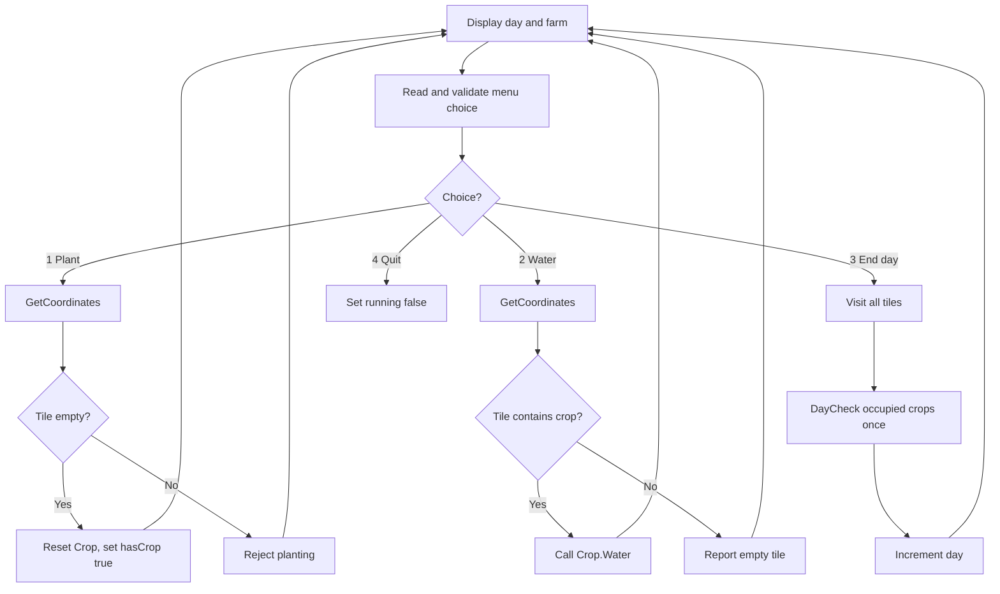

# Day 3 — Console Farming RPG: Working Prototype Checkpoint

> **Checkpoint:** The console prototype supports planting, watering, ending the day, showing crop stages, and quitting. Coordinate and menu input recover from ordinary non-numeric input and reject out-of-range numbers.
>
> **Why this note exists:** This is a learning note, not just a list of finished features. It records what the program is responsible for, why the code is structured this way, how input handling works, how to reason about the control flow, what has been tested, and which limitations remain.

---

## 1. The current game: what happens when it runs?

The player can repeat actions in one program run:

1. See the current day and farm.
2. Choose **Plant**, **Water**, **End day**, or **Quit**.
3. If Plant or Water is selected, choose a row and column.
4. The game checks whether that action is valid for the selected tile.
5. The game returns to the menu without resetting the farm.

The farm is a 3×3 grid, so valid row and column indexes are `0`, `1`, and `2`.

Example display using the current Unicode/emoji symbols:

```text
🟫🟫🟫
🟫🟤🟫
🍂🌱🌿
```

The symbols are only the display. They do not store the crop state.

## 2. The mental model: game state versus displayed symbols

The game keeps its actual state in C++ objects. When drawing the console grid, it reads that state and chooses a symbol to print.

```text
Tile farm[3][3]
└── farm[row][col] is one Tile
    ├── hasCrop : bool
    │   ├── false = this tile is empty in the game world
    │   └── true  = this tile contains a crop
    └── crop : Crop
        ├── current          : Stage
        ├── wateringProgress : int
        ├── grace            : int
        └── wateredToday     : bool
```

### `Crop` owns crop rules

`Crop` is a `class` because it owns both lifecycle data and operations that enforce rules.

- `Stage` is a public enum with `Seed`, `Sprouted`, `Matured`, and `Withered`.
- `current`, `wateringProgress`, `grace`, and `wateredToday` are private.
- `Water()` handles whether watering is allowed and records successful watering.
- `DayCheck()` processes one in-game day's watering/growth/grace result.
- `GetStage() const` lets outside code read the stage without directly modifying it.

The getter must return the current object's actual state:

```cpp
Stage GetStage() const {
    return current;
}
```

Why? `current` is the member storing this particular crop's stage. `Stage` is the enum type. `Crop::Stage()` does not mean “get the current crop's stage”; it constructs/converts an enum value and was the reason the display initially kept showing `Seed`.

`const` at the end of `GetStage()` means the function promises not to modify the `Crop` object through this call.

### `Tile` owns a place in the farm

```cpp
struct Tile {
    bool hasCrop = false;
    Crop crop;
};
```

Every tile contains a `Crop` object in memory, even when the tile is empty. Therefore, the crop's default stage (`Seed`) cannot tell us whether a crop was planted. `hasCrop` answers the occupancy question; `crop.GetStage()` answers the lifecycle question.

This arrangement is called **composition**: a `Tile` contains a `Crop`.

### Why use one `Tile` array?

The earlier design had a character grid plus a separate crop array. Those two arrays represented the same farm locations and could accidentally disagree. The current `Tile farm[3][3]` keeps occupancy and crop data together at each coordinate.

---

## 3. The game loop: why the farm persists

The key variables are declared before the `while (running)` loop:

```cpp
int day = 1;
Tile farm[3][3];
bool running = true;

while (running) {
    // Display farm, get choice, perform one action.
}
```

They are created once for the current game session. The loop repeats the actions, not the declarations. This is why planting a crop, returning to the menu, and planting elsewhere does not erase the first crop.

Current menu:

| Choice | Action | Responsibility |
|---:|---|---|
| `1` | Plant | Select one tile; if empty, reset its crop and mark the tile occupied. |
| `2` | Water | Select one tile; if occupied, call that crop's `Water()`. |
| `3` | End day | Visit the whole grid; call `DayCheck()` once for each occupied tile; then increment `day`. |
| `4` | Quit | Set `running = false`, causing the loop to end. |

### Control-flow map



### Why End Day does not use `GetCoordinates()`

Plant and Water act on **one tile chosen by the player**, so they need `GetCoordinates()`.

End Day acts on **every planted crop**, so it uses nested loops instead:

```cpp
for (int row = 0; row < 3; row++) {
    for (int col = 0; col < 3; col++) {
        if (farm[row][col].hasCrop) {
            farm[row][col].crop.DayCheck();
        }
    }
}
++day;
```

The `hasCrop` check matters because empty tiles also contain default-constructed `Crop` objects. The day counter advances only after the grid has been processed.

---

## 4. `GetCoordinates()` — one job, reused by Plant and Water

The function's name describes its job: obtain a valid row and column from the player. It does **not** plant or water anything. After it returns, the calling action decides what to do with those coordinates.

Its signature is:

```cpp
void GetCoordinates(int& row, int& col)
```

- `void`: it does not return a single value with `return`.
- `int& row` and `int& col`: the parameters are **references** to integer variables provided by the caller.
- The function reads input into these references, so the caller's variables are filled in.

Example of the call from Plant or Water:

```cpp
int r;
int c;
GetCoordinates(r, c);

// After this returns, use r and c to select farm[r][c].
```

If the player enters row `1` and column `2`, then after `GetCoordinates(r, c)` returns, `r == 1` and `c == 2`. References let the function update those existing variables directly.

### What belongs inside this helper?

For the row and then for the column, it must:

1. Prompt for input.
2. Attempt to read an integer.
3. Check whether it is in range (`0 <= value < 3`).
4. If valid, finish that coordinate's loop.
5. If invalid, explain the problem and try again.

The read/prompt belongs inside the retry loop so every iteration makes a fresh input attempt. Do not read once before the loop and then read again inside it; that causes duplicate prompts/input.

The range test needs `&&` (“and”), not `||` (“or”):

```cpp
row >= 0 && row < 3
```

Both parts must be true. For example, row `5` is not valid because `row < 3` is false.

---

## 5. Input handling: what `std::cin` does when input is bad

This section is important. The helper now handles common typing mistakes, so preserve the reasoning rather than memorizing a block of syntax.

### Case A: the user enters an integer outside the allowed range

Example: the row is `5`.

- `std::cin >> row` succeeds: `5` is a valid integer.
- The range check fails because `5` is not less than `3`.
- The code discards the rest of the line, prints the validation message, and loops again.
- `std::cin.clear()` is **not needed** for this case because the stream did not fail to read an integer.

### Case B: the user enters text instead of an integer

Example: the row is `abc`.

When the program attempts `std::cin >> row`, formatted integer extraction cannot convert `abc` to an integer. The input stream enters a failed state, often called `failbit` being set. A subsequent `std::cin >> row` will not behave like a fresh read while that failure remains set.

The recovery has two separate jobs:

1. `std::cin.clear()` resets the stream's error state, allowing later input operations to work again.
2. `std::cin.ignore(std::numeric_limits<std::streamsize>::max(), '\n')` discards characters still waiting in the current input line, through the newline (or until the maximum count is reached).

Why both? `clear()` changes the stream state; it does not remove `abc` from the input buffer. `ignore()` removes unwanted buffered characters; by itself it does not reset a failed stream state. When input fails, both jobs are necessary before retrying.

The program includes `<limits>` so it can use `std::numeric_limits<std::streamsize>::max()` as a large discard limit.

### The recovery pattern in plain language

```text
Try reading an integer.
├─ Read succeeded
│  ├─ Value is in range → discard any remainder of the line and accept it.
│  └─ Value is out of range → discard the line and retry.
└─ Read failed (e.g. "abc")
   ├─ clear() the stream's failure state
   ├─ ignore() the invalid line
   └─ print an error and retry
```

The same idea is used in the **menu** input, but the allowed range is `1` through `4` instead of `0` through `2`.

### Why the braces and `else` placement matter

There are two different questions to ask:

- Did `std::cin >> choice` succeed?
- If it succeeded, is `choice` inside the allowed range?

These are not the same condition. The recovery using `clear()` belongs to the `else` of the **input operation**, because that is the branch that means input conversion failed. An out-of-range integer is a successful read of an invalid choice, not a failed stream operation.

Conceptual menu structure:

```cpp
while (true) {
    std::cout << "Choose an action: ";

    if (std::cin >> choice) {
        if (choice >= 1 && choice <= 4) {
            // Valid choice: discard remaining line and leave the loop.
            break;
        }

        // It was an integer, but outside 1..4: discard the line.
    }
    else {
        // Conversion failed: clear the error state, then discard the line.
    }

    // Report invalid input and retry.
}
```

This is a **conceptual outline** of the flow, not a replacement for the working input code: retain the actual `ignore(...)` calls in both invalid-input paths and the line discard on successful input before `break`.

### Known input limitation

Formatted extraction can accept a numeric prefix. For example, `2abc` may be read as the integer `2`; the remaining `abc` is then discarded by `ignore()`. The current input code handles ordinary non-numeric entries like `hello` and out-of-range numbers, but it does not strictly reject every malformed line. Full-line parsing can be a future improvement; it is not necessary for the current checkpoint.

Also, this code assumes the user is entering interactive input. End-of-file or a permanently closed input stream would need its own handling to avoid retrying forever; that is outside the current prototype's scope.

---

## 6. Crop lifecycle rules in the current implementation

- A fresh crop starts at `Seed`, with `wateringProgress = 0`, `grace = 2`, and `wateredToday = false`.
- A crop can be watered once before the next `DayCheck()`.
- Each successful watering day increases `wateringProgress` by one during `DayCheck()`.
- Three successful watering days advance `Seed` to `Sprouted`; progress resets to zero.
- Three additional successful watering days advance `Sprouted` to `Matured`; progress resets to zero.
- A missed watering day does not increase growth progress.
- A missed day decreases `grace`; when it reaches zero, the crop becomes `Withered`.
- Watering after one missed day restores one grace point up to the maximum of two.
- `Matured` and `Withered` crops cannot be watered.
- `Matured` and `Withered` are terminal stages in the current design.

A withered crop still occupies its tile. Harvesting matured crops and clearing withered crops are deliberately postponed. Because `hasCrop` remains true, the player cannot plant on that tile yet.

### One daily update, one crop

`DayCheck()` must be called once per occupied tile for each End Day action. Calling it twice would process the same in-game day twice (e.g. increase progress twice or decrease grace twice), which would violate the intended game rules.

---

## 7. Display logic

The farm display should decide what to print in this order:

1. Check `hasCrop`.
2. If false, print the empty-land symbol.
3. If true, read `crop.GetStage()` and choose a symbol for that stage.

Current symbols:

| State | Symbol |
|---|---|
| Empty tile | `🟫` |
| Seed | `🟤` |
| Sprouted | `🌱` |
| Matured | `🌿` |
| Withered | `🍂` |

These symbols can change without altering the crop logic. Emoji width and appearance vary by terminal and font; some terminals may not align emojis into a perfect grid. This is a display limitation, not a state-management bug.

---

## 8. Verified behavior and manual test plan

The user reported that the program compiled and ran successfully with the project command. Manual tests covered the following scenarios:

| Test | Expected / observed behavior |
|---|---|
| Start with a new farm | All nine tiles are empty. |
| Plant on an empty tile | Tile becomes occupied and shows the seed symbol. |
| Plant on an occupied tile | Planting is rejected; existing crop remains. |
| Water an empty tile | The program says there is no crop to water. |
| Water a planted crop once | `Water()` reports success. |
| Water the same crop again before End Day | `Water()` rejects the second watering. |
| End Day | Every occupied crop is checked once; the day number advances. |
| Water on a later day | The crop can be watered again after its daily flag resets. |
| Three successful watering days per stage | Crop progresses from seed to sprout, then to mature after three more successful days. |
| Leave a crop unwatered for two consecutive days | Crop becomes withered and shows `🍂`. |
| Try watering a mature/withered crop | Watering is rejected. |
| Enter non-numeric row/column or menu text | Input recovers and prompts again. |
| Enter an out-of-range number | The number is rejected and re-prompted. |
| Quit | Game loop exits. |

The display and growth test revealed a getter bug earlier: `GetStage()` returned `Crop::Stage()` rather than `current`, causing every occupied tile to display as a seed. Returning `current` corrected the display; subsequent testing observed sprout, mature, and withered symbols.

### Build and run

```bash
g++ -std=c++17 -Wall -Wextra -Wpedantic main.cpp -o farm
./farm
```

---

## 9. C++ ideas practised

- **Class vs. struct:** `Crop` protects state and owns behavior; `Tile` groups occupancy and a crop.
- **Composition:** a `Tile` contains a `Crop` object.
- **Encapsulation:** crop fields are private; public methods expose allowed behavior.
- **Getter and `const` member function:** `GetStage() const` reads the state without mutating it.
- **References:** `GetCoordinates(int& row, int& col)` fills caller-owned variables.
- **Functions and refactoring:** repeated coordinate collection moved into one reusable helper without changing Plant or Water's responsibilities.
- **Input-stream state:** understand the difference between failed input and an out-of-range integer.
- **`clear()` vs. `ignore()`:** one resets stream error flags; the other removes buffered characters.
- **Nested loops:** use coordinates to visit all tiles for End Day.
- **Guarded operations:** only run crop behavior when `hasCrop` is true.
- **Persistent state:** farm, day, and running flag are outside the game loop.
- **State vs. presentation:** stage and occupancy determine which symbol is displayed; the symbol itself does not represent state.
- **Debugging through tests:** multi-day tests exposed the getter bug and confirmed the lifecycle transitions.

---

## 10. Deliberately postponed / known limitations

- Harvesting mature crops.
- Clearing withered crops and reusing their tiles.
- Inventory, shops, money, saving/loading, or other extra systems.
- Strictly rejecting trailing junk such as `2abc`.
- Explicit handling of end-of-file/closed input.
- SDL3 window, renderer, event handling, and graphical farm display.
- Reorganizing the repeated validation internals into an additional generic helper; current `GetCoordinates()` already removes coordinate-input duplication between Plant and Water.

The goal is to preserve a small, understandable console prototype before replacing the presentation/input layer with SDL3.

---

## 11. Self-check questions

Try answering these without reading the sections above. If an answer is unclear, return to the relevant section and explain it in your own words.

1. Why does `hasCrop` determine occupancy instead of checking whether `GetStage()` returns `Seed`?
2. What information belongs to `Tile`, and what information belongs to `Crop`?
3. Why are `farm`, `day`, and `running` declared outside the game loop?
4. Why does End Day use nested loops instead of asking the player for coordinates?
5. Why must `DayCheck()` run exactly once per occupied tile for each End Day action?
6. What does `int& row` mean in `GetCoordinates()`?
7. Why does moving coordinate input into `GetCoordinates()` help both Plant and Water?
8. What is the difference between a failed extraction (`std::cin >> row` fails) and an integer that is outside `0..2`?
9. Why are `std::cin.clear()` and `std::cin.ignore(...)` both needed after non-numeric input?
10. Why must the menu's failed-input `else` belong to `if (std::cin >> choice)`, rather than to the range check?
11. Why does `GetStage()` return `current` instead of `Crop::Stage()`?
12. What should happen if a crop withers, and why does it still occupy its tile in the current program?
13. Which parts of the program should change when the farm is drawn with SDL3, and which crop rules should remain independent of rendering?

---

## 12. Next milestone: SDL3 foundations

This is the Day 3 console-prototype checkpoint. The next phase should introduce SDL3 in small steps:

1. Set up and build a minimal SDL3 program on Linux.
2. Open a window and understand the event loop.
3. Create a renderer and present a cleared frame.
4. Draw a simple grid before adding crop sprites.
5. Connect the existing farm state and actions to graphical input/display without rewriting crop lifecycle rules merely to change the presentation.

Harvesting and clearing withered crops remain postponed until a later, clearly scoped checkpoint.
