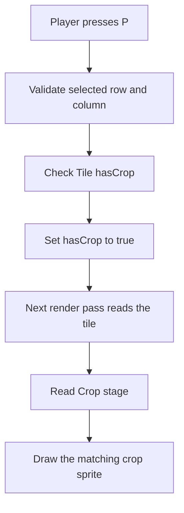

# Day 5 — SDL3 Farming RPG: Making the Farm Visible

> **Checkpoint:** Day 5. The SDL3 prototype can display a tiled grassy world, a clearly marked 3×3 farm plot, crop sprites, and a selected-tile outline. The mouse selects tiles; `P`, `W`, and `E` plant, water, and advance the day. Some messages still appear in the terminal.
>
> These notes describe the code and decisions at this checkpoint. They are a learning reference, not a claim that the game is finished.

## How to use these notes

Don't try to memorize the source file line by line. The goal is to understand the ideas well enough to explain them and make small changes yourself.

A useful routine:

1. Read one section and look at the matching part of `sdl3_window.cpp`.
2. Close the notes and explain the idea in your own words, even if the explanation is rough.
3. Reopen the notes to correct your understanding.
4. Make one small change, compile, and check what happened.

It is completely reasonable to need help understanding an unfamiliar API. The important part is to turn that help into a model you can use again—not to pretend you never needed help.

## What works now

| Input | Current behaviour |
|---|---|
| Left-click inside a farm tile | Selects that tile and draws a black outline around it |
| `P` | Plants a crop on the selected tile if it is empty |
| `W` | Attempts to water the selected crop |
| `E` | Runs `DayCheck()` on planted crops and advances the day counter |
| Close the window | Requests the program to stop |

The window is 800×600 pixels. The farm has 3 rows and 3 columns. Each farm tile is 96×96 pixels. The surrounding world is drawn with 48×48 background tiles.

## Project structure: what each file is responsible for

```text
assets/
    └── vectoraith/
        ├── crops.png
        └── terrain_summer_expanded.png
src/
├── farm.hpp
│   └── Shared Crop class and Tile struct
├── main.cpp
│   └── Original console game and console menu
├── sdl3_window.cpp
│   └── SDL window, events, textures, rendering, graphical input
```

### `farm.hpp` — game state and rules

`Crop` owns crop-related state and rules: its stage, watering progress, grace allowance, and whether it has been watered today. Methods such as `Water()`, `DayCheck()`, and `GetStage()` belong to the crop.

`Tile` groups together:

- `hasCrop`: whether a crop has actually been planted on this tile;
- `crop`: the `Crop` object associated with the tile.

The header is shared by both versions of the game.

### `main.cpp` — console interface

This is the console version. It handles terminal input and output. Keep it as a useful reference while the SDL version develops.

### `sdl3_window.cpp` — graphical interface

This file handles SDL initialization, the window, textures, mouse and keyboard events, drawing, and cleanup. It also owns a `Tile farm[FARM_SIZE][FARM_SIZE]` array for this running SDL program.

The two `.cpp` files are separate executable programs. Do not link them into one executable while both have a `main()` function. They share type definitions through `farm.hpp`, but they do not share a live farm state between processes.

---

## The most important mental model: state is not artwork

The game state describes what is happening. Rendering turns that state into pixels on the screen.

For example:

```cpp
if(farm[row][col].hasCrop) {
    Crop::Stage stage = farm[row][col].crop.GetStage();
    // Choose and draw the sprite for this stage.
}
```

`hasCrop` answers, “Is a crop planted here?” `GetStage()` answers, “What stage is that crop at?” Neither one is a picture. The renderer reads those values and chooses which picture to display.

This matters because a `Tile` contains a `Crop` member even when the tile is empty. The crop object can have its default stage (`Seed`) while `hasCrop` is still `false`. Therefore, **do not use the crop's stage to determine whether a tile is occupied**. Use `hasCrop` for occupancy.

The renderer does not make a crop grow. The `Crop` logic changes its stage; rendering notices the changed stage and displays the matching sprite.



---

## The frame loop: how an SDL game stays alive

A console program often reads input, performs an action, prints a result, and continues. A graphical program also needs to keep a window responsive and refresh what is displayed.

The main shape of the current program is:

```text
while the game is running:
    process all queued SDL events
    clear the current frame
    draw the background
    draw the farm ground
    draw crop sprites
    draw the selected-tile outline
    present the finished frame
    briefly delay
```

### The outer loop

```cpp
bool running = true;

while(running) {
    // Handle events and render a frame.
}
```

`running` remains alive between iterations. When SDL reports that the window should close, the code sets `running = false`. The outer loop stops when its condition is checked again, and execution proceeds to cleanup.

### The event loop inside it

```cpp
SDL_Event event;

while(SDL_PollEvent(&event)) {
    // Inspect and handle one event at a time.
}
```

`SDL_Event` is a variable that receives information about a mouse click, key press, window-close request, and other events. `SDL_PollEvent()` asks SDL for the next waiting event and fills in `event`. The `&event` passes the variable's address so SDL can write into it.

There are two loops because they do different jobs:

- The inner loop handles the events currently waiting in SDL's event queue.
- The outer loop keeps the application running and repeatedly draws new frames.

An event is a notification that something happened; it is not the game action itself. The event handler decides what that notification should do to the game state.

### Why check `!event.key.repeat`?

The key handlers include checks such as:

```cpp
else if(event.type == SDL_EVENT_KEY_DOWN &&
        event.key.key == SDLK_P && !event.key.repeat) {
```

`SDL_EVENT_KEY_DOWN` means a key-down event has occurred. `SDLK_P` identifies the P key. `!event.key.repeat` rejects repeated key-down events generated when a player holds the key down. This is useful for actions such as advancing a day: holding E should not accidentally advance several days.

### Presenting a frame

```cpp
SDL_RenderPresent(renderingPointer);
SDL_Delay(16);
```

`SDL_RenderPresent()` shows the frame we have drawn. It comes after the drawing commands so the player sees the assembled scene rather than an unfinished sequence of drawing steps.

`SDL_Delay(16)` pauses for about 16 milliseconds. That is approximately one-sixtieth of a second, but it is not a precise frame-rate system: event processing and rendering time also contribute to the frame duration. Proper frame timing can wait until the game needs it.

---

## SDL vocabulary: the objects and rectangles

### Window — `SDL_Window`

The window is the desktop window itself. It provides the place where the game appears; it is not the farm image.

### Renderer — `SDL_Renderer`

The renderer performs our 2D drawing operations. In this source file its pointer is named `renderingPointer`. It is passed into calls that clear the screen, draw textures or rectangles, and present the frame.

### Texture — `SDL_Texture`

A texture is an image resource that SDL's renderer can draw. We load the PNG files into textures once, then reuse those textures for many drawing calls.

### Event — `SDL_Event`

An event carries information about something that happened, such as a click or key press. The handler checks `event.type` to determine which kind of event it is and reads the appropriate fields.

### Rectangle — `SDL_FRect`

`SDL_FRect` describes a rectangle using floating-point values:

```cpp
SDL_FRect rect{x, y, w, h};
```

- `x`: horizontal coordinate;
- `y`: vertical coordinate;
- `w`: width;
- `h`: height.

The rectangle itself does not inherently mean “image coordinates” or “screen coordinates.” Its meaning depends on which SDL function receives it. In our rendering calls, the source rectangle describes part of an image, while the destination rectangle describes where something should be drawn on screen.

---

## Loading PNG files and creating textures

The program loads two images before the main loop:

```cpp
SDL_Texture* cropSheet = IMG_LoadTexture(
    renderingPointer,
    "./assets/vectoraith/crops.png"
);

SDL_Texture* terrainSheet = IMG_LoadTexture(
    renderingPointer,
    "./assets/vectoraith/terrain_summer_expanded.png"
);
```

`IMG_LoadTexture()` comes from SDL3_image, the image-loading add-on. It loads the image and creates a texture the renderer can use.

### Why load the image before the main loop?

The source images do not change during normal play. Loading them once avoids repeatedly decoding the same files and creating resources every frame. The same texture can be drawn many times using different source and destination rectangles.

### Why check for `nullptr`?

Texture creation can fail if the file path is incorrect, the file is missing, or the image cannot be loaded. When that happens, `IMG_LoadTexture()` returns `nullptr` rather than a usable texture pointer.

The program checks this and prints `SDL_GetError()` to help identify the problem. It then releases anything that was already created before exiting. If terrain loading fails after the crop texture has been loaded, for example, the crop texture must also be destroyed.

### Relative file paths

The paths begin with `./`, which means they are relative to the program's **current working directory**. They are not automatically relative to the source file's location. With the current paths, launch the program from the repository root:

```bash
./sdl3_window
```

### Nearest-neighbor scaling

```cpp
SDL_SetTextureScaleMode(cropSheet, SDL_SCALEMODE_NEAREST);
SDL_SetTextureScaleMode(terrainSheet, SDL_SCALEMODE_NEAREST);
```

Pixel-art images contain sharp pixel edges and small blocks of solid color. Nearest-neighbor scaling enlarges those pixels without blending neighboring colors, helping the art remain crisp instead of blurry.

---

## Sprite sheets: choosing pixels and placing them on screen

A sprite sheet is one image containing many smaller pieces of artwork. `crops.png` has several crop images; `terrain_summer_expanded.png` has grass and terrain pieces.

To draw one small piece, we need two separate decisions:

1. Which pixels should SDL take from the image?
2. Where should SDL draw those pixels, and at what size?

Those are described by two different rectangles.

### Source rectangle: which pixels to take

For example:

```cpp
SDL_FRect sourceRect{195.0f, 18.0f, 11.0f, 11.0f};
```

These numbers refer to the loaded image, not to the game window:

- start at image X = 195;
- start at image Y = 18;
- take an area 11 pixels wide;
- take an area 11 pixels tall.

Imagine a page of stickers. The source rectangle is the box around the sticker we want to use.

### Destination rectangle: where to draw it

```cpp
SDL_FRect destinationRect{
    279.0f,
    229.0f,
    33.0f,
    33.0f
};
```

These numbers describe the screen:

- draw with its top-left corner at screen position `(279, 229)`;
- display it 33 pixels wide and 33 pixels tall.

Imagine the game window as a canvas. The destination rectangle is where we place the sticker on that canvas and how large we make it.

### The drawing call combines the two

```cpp
SDL_RenderTexture(
    renderingPointer,
    cropSheet,
    &sourceRect,
    &destinationRect
);
```

In plain English: “Use `renderingPointer` to draw from `cropSheet`. Take the pixels inside `sourceRect`, and put them inside `destinationRect` on the screen.”

The arguments have these roles:

| Argument | Meaning |
|---|---|
| `renderingPointer` | Which renderer draws it |
| `cropSheet` | Which loaded image to draw from |
| `&sourceRect` | The address of the source rectangle (which pixels) |
| `&destinationRect` | The address of the destination rectangle (where and how large) |

`&sourceRect` means “the address of `sourceRect`.” The SDL function accepts pointers to these rectangle descriptions. Passing the address avoids making a separate rectangle copy for the call.

The source rectangle in our terrain loop is already a pointer (`backgroundSource`), so the code passes it directly rather than writing `&backgroundSource`. The pointer is not the rectangle itself; it already contains an address.

### Diagnosing a wrong-looking sprite

Separate the possibilities:

- **Wrong artwork appears:** check the source rectangle.
- **Correct artwork, wrong position:** check destination `x` and `y`.
- **Correct artwork and position, wrong size:** check destination `w` and `h` or the scaling calculation.
- **Artwork is blurry:** check the texture's scaling mode.
- **Artwork is hidden:** check whether a later draw call covered it.

This separation is much faster than changing several unrelated numbers at once.

---

## The four crop sprites currently used

These coordinates are tied to the exact file `assets/vectoraith/crops.png`.

| Crop stage | Source rectangle `{x, y, w, h}` | Source size | Sprite selected for this stage |
|---|---|---|---|
| `Seed` | `{195, 18, 11, 11}` | 11×11 | Small early crop |
| `Sprouted` | `{209, 12, 13, 17}` | 13×17 | Green sprout |
| `Withered` | `{225, 7, 14, 22}` | 14×22 | Temporary choice for withered state; still looks fairly green |
| `Matured` | `{241, 7, 14, 22}` | 14×22 | Mature crop |

The code reads the stage:

```cpp
Crop::Stage stage = farm[row][col].crop.GetStage();
SDL_FRect sourceRect{};

if(stage == Crop::Seed) {
    sourceRect = SDL_FRect{195.0f, 18.0f, 11.0f, 11.0f};
}
else if(stage == Crop::Sprouted) {
    sourceRect = SDL_FRect{209.0f, 12.0f, 13.0f, 17.0f};
}
else if(stage == Crop::Withered) {
    sourceRect = SDL_FRect{225.0f, 7.0f, 14.0f, 22.0f};
}
else if(stage == Crop::Matured) {
    sourceRect = SDL_FRect{241.0f, 7.0f, 14.0f, 22.0f};
}
```

The braces in `SDL_FRect sourceRect{};` initialize the rectangle to zero values first. The `if` / `else if` chain then assigns the rectangle for the current stage.

The stage names do not need to be in the same order as the art in the image. We explicitly map each stage to a source rectangle.

**Coordinate warning:** a source rectangle only makes sense for the exact file it was measured from. These coordinates should not be copied blindly to another crop sheet, terrain sheet, or tile-size variant.

---

## Scaling and aligning crop sprites inside a tile

The farm tiles are 96×96 pixels on screen, but the sprites are much smaller in the PNG. The code enlarges each crop by a factor of three:

```cpp
constexpr float spriteScale = 3.0f;
float spriteW = sourceRect.w * spriteScale;
float spriteH = sourceRect.h * spriteScale;
```

The multiplication is performed separately for width and height so the crop keeps its proportions.

| Stage | Source size | Display size at 3× |
|---|---:|---:|
| Seed | 11×11 | 33×33 |
| Sprouted | 13×17 | 39×51 |
| Withered | 14×22 | 42×66 |
| Matured | 14×22 | 42×66 |

### Horizontal centering

The farm tile is `TILE_SIZE` pixels wide. The sprite is `spriteW` pixels wide. The unused space is `TILE_SIZE - spriteW`; to center it, put half of that space on each side:

```cpp
x + (TILE_SIZE - spriteW) / 2.0f
```

Example: if the tile is 96 pixels wide and the crop is 42 pixels wide, there are `96 - 42 = 54` empty pixels. Half is 27, so the sprite starts 27 pixels to the right of the tile's left edge.

### Aligning the crop bottoms

We want crops to look like they grow upward, not like the bottom of the plant jumps around every time its sprite changes size.

```cpp
y + TILE_SIZE - 8.0f - spriteH
```

Read this from left to right:

1. `y` is the tile's top edge.
2. `y + TILE_SIZE` is the tile's bottom edge.
3. `- 8.0f` leaves an 8-pixel margin above the bottom edge.
4. `- spriteH` moves upward by the crop's height to calculate the sprite's top edge.

The crop destination rectangle is therefore:

```cpp
SDL_FRect destinationRect{
    x + (TILE_SIZE - spriteW) / 2.0f,
    y + TILE_SIZE - 8.0f - spriteH,
    spriteW,
    spriteH
};
```

This calculation positions the crop; it does not change the crop's stage or watering state.

---

## The world background: the nested loops, slowly explained

This section explains the background loop in detail because it combines several C++ ideas with SDL rendering: nested `for` loops, multiple loop variables, arithmetic, pointers, rectangles, and a texture draw call.

### What the code is trying to do

The background is not one enormous image. We repeat small terrain pieces across the window:

- most positions use ordinary grass;
- a few positions use decorative grass variants;
- each background tile is drawn as a 48×48 square;
- the terrain pieces are selected from a 16×16 region in the terrain texture.

The source piece is 16×16 and the destination square is 48×48, so each piece is displayed at three times its source size.

### First, the nested loops

```cpp
for(int bgRow = 0, bgY = 0;
    bgY < WINDOW_H;
    bgRow++, bgY += BACKGROUND_TILE_SIZE) {

    for(int bgCol = 0, bgX = 0;
        bgX < WINDOW_W;
        bgCol++, bgX += BACKGROUND_TILE_SIZE) {

        // Pick a source tile, create a destination rectangle, and draw it.
    }
}
```

A `for` loop has three parts:

```cpp
for(initialization; condition; update)
```

In this code, the outer loop uses **two variables**:

```cpp
int bgRow = 0, bgY = 0;
```

They both start at zero, but they mean different things:

| Variable | What it tracks | Example values |
|---|---|---|
| `bgRow` | The row index of the background tile | `0, 1, 2, 3, ...` |
| `bgY` | The tile's Y position in screen pixels | `0, 48, 96, 144, ...` |

The update part advances both:

```cpp
bgRow++, bgY += BACKGROUND_TILE_SIZE
```

`bgRow++` means increment the row index by one. `bgY += BACKGROUND_TILE_SIZE` adds 48 to the Y position. The comma separates two expressions that are both performed by the update part.

The inner loop does the same thing horizontally:

| Variable | What it tracks | Example values |
|---|---|---|
| `bgCol` | The column index | `0, 1, 2, 3, ...` |
| `bgX` | The tile's X position in screen pixels | `0, 48, 96, 144, ...` |

Why keep both an index and a pixel position? The index helps us decide which variation to draw. The pixel coordinate tells SDL where to draw it.

### What does “nested” mean here?

The inner loop runs through all columns for the current outer-loop row. When the inner loop finishes, the outer loop advances to the next row, and the inner loop starts over at the first column.

With a 48-pixel tile size, the first few positions are:

| `bgRow` | `bgCol` | `bgX` | `bgY` |
|---:|---:|---:|---:|
| 0 | 0 | 0 | 0 |
| 0 | 1 | 48 | 0 |
| 0 | 2 | 96 | 0 |
| 0 | 3 | 144 | 0 |
| 1 | 0 | 0 | 48 |
| 1 | 1 | 48 | 48 |
| 1 | 2 | 96 | 48 |

It visits each column before moving down to the next row. In a 2D grid, `row` usually describes vertical position and `col` describes horizontal position.

### Why do the loops use `bgY < WINDOW_H` and `bgX < WINDOW_W`?

The loops continue as long as the tile's top-left coordinate is inside the window's width or height. Because 800 and 600 are not both exact multiples of 48, the last row and column extend a little beyond the window. That's fine: the renderer clips drawing outside the window.

With an 800×600 window and a 48-pixel tile, the loop starts tiles at X positions `0` through `768` (17 columns) and Y positions `0` through `576` (13 rows). The last background tiles cover the edges without leaving a gap.

### Choosing which terrain patch to use

```cpp
const SDL_FRect* backgroundSource = &grassSource;
int pattern = (bgCol * 7 + bgRow * 11) % 9;

if(pattern == 0) {
    backgroundSource = &wildGrassA;
}
else if(pattern == 5) {
    backgroundSource = &wildGrassB;
}
```

Start with the first line:

```cpp
const SDL_FRect* backgroundSource = &grassSource;
```

- `SDL_FRect` is the rectangle type.
- `*` in the declaration means `backgroundSource` is a pointer to an `SDL_FRect`.
- `const SDL_FRect*` means we should not modify the rectangle through this pointer.
- `&grassSource` means “the address of `grassSource`.”

The pointer variable itself can still be reassigned to point at another rectangle. The `const` applies to the rectangle being pointed at, not to the pointer variable.

So the first line means: “Start by selecting the ordinary grass source rectangle.” Then the `if` statements may redirect that choice to a decorative variant.

This statement does **not** copy or alter the grass rectangle. It makes `backgroundSource` refer to it. Think of a pointer as a signpost to an existing object.

### How the `pattern` value works

```cpp
int pattern = (bgCol * 7 + bgRow * 11) % 9;
```

This combines the row and column indices into a number. `%` is the remainder operator:

```cpp
17 % 9   // 8
18 % 9   // 0
19 % 9   // 1
```

For a non-negative value, `% 9` produces a result from `0` through `8`. The background code uses two of those values:

- `pattern == 0`: use `wildGrassA`;
- `pattern == 5`: use `wildGrassB`;
- any other value: keep the normal grass.

The multipliers `7` and `11` are design choices that help distribute the variants. They are not special SDL values and do not make the pattern genuinely random. The same row and column always produce the same pattern, which is useful because the background should remain steady from frame to frame.

### Creating the destination rectangle

```cpp
SDL_FRect backgroundTile{
    static_cast<float>(bgX),
    static_cast<float>(bgY),
    static_cast<float>(BACKGROUND_TILE_SIZE),
    static_cast<float>(BACKGROUND_TILE_SIZE)
};
```

This rectangle means:

- draw at pixel position `(bgX, bgY)`;
- draw a square `BACKGROUND_TILE_SIZE` pixels wide;
- draw it `BACKGROUND_TILE_SIZE` pixels tall.

`bgX`, `bgY`, and `BACKGROUND_TILE_SIZE` are integers. `static_cast<float>(...)` explicitly converts each value to the floating-point type used by `SDL_FRect`.

For the first background tile, the rectangle is positioned at `(0, 0)` with size 48×48. The next is at `(48, 0)`, then `(96, 0)`, and so on.

### Drawing the chosen terrain patch

```cpp
SDL_RenderTexture(
    renderingPointer,
    terrainSheet,
    backgroundSource,
    &backgroundTile
);
```

This one call combines the choices made above:

- `renderingPointer`: renderer to draw with;
- `terrainSheet`: image containing the terrain art;
- `backgroundSource`: which 16×16 patch to use;
- `&backgroundTile`: where to draw it as a 48×48 square.

`backgroundSource` is already a pointer, so it is passed directly. `backgroundTile` is a rectangle object, so we pass `&backgroundTile` to provide its address.

The complete operation for each position is therefore:

```text
Start by selecting ordinary grass
    ↓
Calculate a pattern number from row and column
    ↓
Maybe select a decorative grass patch instead
    ↓
Create a screen rectangle at (bgX, bgY), size 48×48
    ↓
Draw the selected source patch into that rectangle
```

The loops repeat this process until the background covers the window.

---

## The farm plot: a separate visual layer

The world background is scenery. The farm array represents the nine cells where the current prototype allows farming. The two are kept separate.

### Why all nine empty tiles are sandy

Initially, grass on an empty farm tile looked the same as grass outside the farm. It was hard to tell where planting was allowed. The current design draws sandy ground on all nine farm cells, even when no crop is planted.

- Outside the plot: grass.
- Inside the plot: sandy ground.
- On an occupied tile: crop sprite on top of the ground.

The sandy tile is a clear placeholder, not a final soil texture.

### The farm geometry

```cpp
constexpr int WINDOW_W = 800;
constexpr int WINDOW_H = 600;

constexpr int GRID_X = 256;
constexpr int GRID_Y = 156;
constexpr int TILE_SIZE = 96;
constexpr int FARM_SIZE = 3;
```

The entire farm plot is `3 * 96 = 288` pixels wide and 288 pixels tall. To center it in the window:

```text
GRID_X = (800 - 288) / 2 = 256
GRID_Y = (600 - 288) / 2 = 156
```

That gives the farm's top-left position `(256, 156)`. Each tile's position is calculated from its row and column:

```cpp
float x = static_cast<float>(GRID_X + col * TILE_SIZE);
float y = static_cast<float>(GRID_Y + row * TILE_SIZE);
```

For example, column 0 starts at X = 256, column 1 at X = 352, and column 2 at X = 448. Row 0 starts at Y = 156, row 1 at Y = 252, and row 2 at Y = 348.

### Terrain source rectangles used now

These source rectangles refer specifically to `terrain_summer_expanded.png`:

| Name | Source rectangle `{x, y, w, h}` | Purpose |
|---|---|---|
| `grassSource` | `{0, 16, 16, 16}` | Base grass outside the farm |
| `wildGrassA` | `{16, 0, 16, 16}` | Decorative grass variation |
| `wildGrassB` | `{32, 0, 16, 16}` | Another decorative variation |
| `sandyGroundSource` | `{16, 48, 16, 16}` | Sandy ground inside the farm |

The sheet includes standalone ground pieces as well as decorations and transition tiles. Not every 16×16 rectangle is a good tile to repeat by itself; some have corners or edges meant to connect to neighboring tiles. Earlier repeated corner patterns came from choosing the wrong source regions and from mixing coordinates between different terrain images.

**Debugging rule:** confirm the exact image first, then confirm the source rectangle. Coordinates from `terrains.png`, `terrain_A5_summer.png`, and `terrain_summer_expanded.png` are not interchangeable.

---

## Mouse selection: converting screen pixels to a farm tile

The mouse reports a position in window coordinates. The farm array needs row and column indices. We convert from one coordinate system to the other.

### Start with the farm's position

The top-left of the farm is `(GRID_X, GRID_Y)`, currently `(256, 156)`. Each tile is 96×96 pixels.

On a left mouse click:

```cpp
int relativeX = static_cast<int>(event.button.x) - GRID_X;
int relativeY = static_cast<int>(event.button.y) - GRID_Y;
int farmPixelSize = TILE_SIZE * FARM_SIZE;
```

`relativeX` and `relativeY` measure how far the click is from the farm's top-left corner. This is a coordinate conversion: instead of measuring from the window's top-left, it measures from the farm's top-left.

### Reject clicks outside the plot

```cpp
if(relativeX < 0 || relativeX >= farmPixelSize ||
   relativeY < 0 || relativeY >= farmPixelSize) {
    continue;
}
```

The total farm width and height are both `96 * 3 = 288` pixels. A valid relative coordinate must be at least 0 and strictly less than 288.

Why use `>=` for the upper limit? A coordinate exactly equal to 288 is already beyond the last pixel of the farm area. The valid pixel span is from 0 through 287.

The bounds check must happen **before** calculating or using array indices. A click outside the farm should not produce an invalid array access.

### Convert relative pixels to row and column

```cpp
selectedCol = relativeX / TILE_SIZE;
selectedRow = relativeY / TILE_SIZE;
```

Integer division maps each 96-pixel range to one index:

| Relative coordinate | Index |
|---:|---:|
| 0–95 | 0 |
| 96–191 | 1 |
| 192–287 | 2 |

This works because the farm tiles sit directly beside one another with no gaps.

`selectedRow` and `selectedCol` are initialized to `-1`. That value is a sentinel meaning “there is no valid selection yet.” Before using those indices to access `farm`, the code checks they are inside the valid range.

A click outside the farm is ignored and currently leaves the previous selection unchanged. Clicking outside does not clear the selection in this version.

---

## Planting, watering, and ending the day

### Planting with `P`

The handler performs these checks in order:

1. Is a tile selected?
2. Does that tile already contain a crop?
3. If neither blocks the action, mark it as occupied.

The final operation is:

```cpp
farm[selectedRow][selectedCol].hasCrop = true;
```

Planting does not directly call a drawing function. It changes the game state. During the following rendering pass, the code finds `hasCrop == true`, reads the crop's stage, and draws the Seed sprite.

The order of validation matters. Since the initial row and column are `-1`, using `farm[selectedRow][selectedCol]` before validating the selection would be invalid.

### Watering with `W`

After checking that a valid tile is selected and occupied, the SDL handler calls:

```cpp
farm[selectedRow][selectedCol].crop.Water();
```

The rules remain inside `Crop::Water()`. The SDL code does not need a second implementation of crop watering. At this checkpoint, `Water()` uses `std::cout`, so its messages appear in the terminal rather than inside the SDL window.

### Ending the day with `E`

```cpp
for(int row = 0; row < FARM_SIZE; row++) {
    for(int col = 0; col < FARM_SIZE; col++) {
        if(farm[row][col].hasCrop) {
            farm[row][col].crop.DayCheck();
        }
    }
}

day++;
```

The outer loop visits each row; the inner loop visits each column in that row. The `hasCrop` check avoids processing the empty tiles' default `Crop` members. After the planted crops are checked, the day counter increases.

The current `farm.hpp` rules are reused: watering progress advances at the day check, growth proceeds through Seed → Sprouted → Matured, and missed watering days consume the crop's grace allowance until a growing crop withers. The precise rules belong to `Crop`, not to SDL rendering.

---

## Drawing order: why the order of calls matters

SDL performs drawing operations in the order the program issues them. The renderer does not automatically know that one object is “the background” and another is “the foreground.” We establish the layers by drawing them in the correct sequence.

The current frame is drawn in this order:

1. Clear the frame with a dark base color.
2. Draw grass tiles across the window.
3. Draw sandy ground for each farm tile.
4. If a tile is occupied, draw its crop sprite on top of that ground.
5. If a tile is selected, draw the black outline last.
6. Present the finished frame.

If we drew the ground after the crop, opaque ground pixels could cover the crop. If we drew the outline before the ground, the ground could hide the outline.

### PNG transparency

The crop PNG has transparent pixels around the artwork. Those pixels allow the previously drawn sandy ground to show through. We do not need to draw a solid rectangle behind every crop sprite.

A previous placeholder rectangle was removed because a later opaque rectangle can cover a correctly drawn sprite. When a sprite seems invisible, check the order of drawing calls before assuming its source rectangle is wrong.

### The selection outline

The selection test happens after drawing the ground and crop:

```cpp
if(row == selectedRow && col == selectedCol) {
    SDL_SetRenderDrawColor(renderingPointer, 0, 0, 0, 255);
    SDL_RenderRect(renderingPointer, &tileRect);
}
```

`SDL_SetRenderDrawColor()` sets the color used by drawing operations that use the renderer's draw color. `SDL_RenderRect()` draws the outline of the tile rectangle. The code uses black with alpha 255 (fully opaque), and does this last so the outline stays visible.

---

## Cleanup and error handling

The program creates resources in this general order:

1. Initialize SDL.
2. Create the window.
3. Create the renderer.
4. Load the crop texture.
5. Load the terrain texture.

On normal shutdown, it destroys the texture resources before the renderer, then the window, and finally quits SDL:

```cpp
SDL_DestroyTexture(terrainSheet);
SDL_DestroyTexture(cropSheet);
SDL_DestroyRenderer(renderingPointer);
SDL_DestroyWindow(window);
SDL_Quit();
```

The texture resources are used by the renderer, so destroy the textures before destroying the renderer. Similarly, destroy the renderer before its window.

The early error paths follow the same principle: if creation of a later resource fails, release the resources that were already created, then exit. Do not continue to render using a null texture or renderer.

---

## Build and run on GNU/Linux

The SDL program needs a C++ compiler, SDL3 development files, SDL3_image development files, and `pkg-config` (or a compatible `pkgconf` installation). The package-manager names vary across GNU/Linux distributions, so install the equivalent development packages for your distribution.

Build the console program separately:

```bash
g++ -std=c++17 -Wall -Wextra -Wpedantic main.cpp -o farm
```

Build the SDL3 program:

```bash
g++ -std=c++17 -Wall -Wextra -Wpedantic \
    sdl3_window.cpp -o sdl3_window \
    $(pkg-config --cflags --libs sdl3 sdl3-image)
```

Run from the repository root so the relative asset paths resolve:

```bash
./sdl3_window
```

If compilation complains about missing headers or libraries, verify the development packages and the `pkg-config` module names. For this project the module names used by the build command are `sdl3` and `sdl3-image`.

---

## Asset paths and licensing reminder

The current source expects these two paths:

```text
assets/vectoraith/crops.png
assets/vectoraith/terrain_summer_expanded.png
```

The asset pack contains multiple variants and tile sizes. The selected coordinates are tied to the particular PNGs above, not to the pack in general.

Keep the pack's license/readme with your local copy and check its terms before redistributing assets. The terms we reviewed restrict redistribution of the raw asset files, so do not commit the complete raw pack to a public repository unless the license explicitly permits that use. Code that loads local assets still requires other users to obtain those files through a permitted route.

---

## What went wrong during terrain integration

These mistakes were useful lessons because they show how to debug a visual problem systematically.

### A source rectangle had the right size but selected the wrong artwork

A 16×16 region is not automatically a complete, repeatable grass tile. Some regions contain corners, edges, or transitions meant to connect to other tiles. Repeating one can create a visible pattern of repeated corners.

**Lesson:** inspect the actual pixels. Correct dimensions do not guarantee the right image content.

### Coordinates from different images were mixed

The pack contains similar-looking terrain sheets with different layouts. `(16, 48)` means a particular region only when paired with the correct image.

**Lesson:** source coordinates belong to an exact file. Confirm the file loaded by `IMG_LoadTexture()` before adjusting rectangles.

### Empty farm cells blended into the world

Using grass for empty cells meant the farm plot did not visually stand out until something was planted. We now draw sandy ground in every farm cell.

**Lesson:** occupancy and terrain are separate concepts. `hasCrop` represents the presence of a crop, not whether a location is farmable or what its ground looks like.

### A later rectangle covered a sprite

A correct sprite can be drawn and then hidden by a later opaque draw operation.

**Lesson:** inspect draw order. Ground first, crop after it, selection outline last.

---

## Known limitations — deliberately not solved yet

- The farm is fixed at 3×3 tiles.
- Sandy ground is a placeholder for a final tilled-soil tile.
- The selected Withered sprite still looks relatively green.
- The world is a repeated grass pattern, not a designed map with paths, fences, buildings, or collision.
- No farmer character is rendered or controlled yet.
- There is no on-screen text or action menu; messages from crop methods still appear in the terminal.
- There is no harvesting, inventory, money, shop, saving, or loading.
- Clicking outside the farm leaves the previous selection active.
- `sdl3_window.cpp` currently keeps setup, input, state, and rendering in one source file. That is acceptable for the current learning stage; refactoring should have a concrete purpose.
- The console and SDL versions run as separate programs with separate live farm arrays.

These are current boundaries, not reasons to throw away the working prototype.

---

## Manual test checklist

After changing input, crop logic, or drawing code, run a short regression check.

### Startup and shutdown

- [ ] Launch `./sdl3_window` from the repository root.
- [ ] Confirm the 800×600 window opens.
- [ ] Confirm grass fills the area around the farm.
- [ ] Confirm all nine farm cells show sandy ground before planting.
- [ ] Close the window and confirm the process exits cleanly.

### Selection and planting

- [ ] Click each of the nine tiles and confirm the outline moves correctly.
- [ ] Click outside the farm and confirm no invalid tile is accessed.
- [ ] Press `P` before selecting a tile and confirm the action is rejected.
- [ ] Plant on an empty tile and confirm the Seed sprite appears.
- [ ] Try planting again on the same tile and confirm it is rejected.

### Watering and growth

- [ ] Press `W` without a valid selection and confirm the action is rejected.
- [ ] Press `W` on an empty tile and confirm the action is rejected.
- [ ] Water a planted crop and check the terminal message.
- [ ] Water it again without ending the day and confirm duplicate watering is rejected.
- [ ] Press `E` and confirm the day advances.
- [ ] Repeat watering across the needed days and verify the crop sprites change with the `Crop` stage.
- [ ] Skip enough watering days to verify the withering rule.

### Rendering

- [ ] Verify crop sprites look crisp when enlarged.
- [ ] Verify transparent crop pixels reveal the ground beneath.
- [ ] Verify the crop draws on top of the ground.
- [ ] Verify the selection outline draws on top of the crop.
- [ ] Verify the background remains stable between frames.

---

## Troubleshooting reference

| Symptom | First thing to inspect |
|---|---|
| Texture fails to load | Relative path, filename capitalization, working directory, and `SDL_GetError()` |
| Wrong sprite from a sheet | Source rectangle and the exact PNG used |
| Sprite is in the correct place but too large or small | Destination width/height and `spriteScale` |
| Sprite is blurry | Texture scaling mode (`SDL_SCALEMODE_NEAREST`) |
| Crop disappears behind ground | Order of render calls; remove old opaque placeholders after the sprite call |
| All tiles seem occupied | Check `Tile::hasCrop` initialization and remove temporary test assignments |
| Click selects the wrong tile | Ensure the click conversion and tile rendering use the same `GRID_X`, `GRID_Y`, and `TILE_SIZE` |
| Green corners repeat across the field | Verify the selected terrain rectangle is a standalone tile from the exact loaded sheet |
| SDL_image symbols or headers are missing | Include SDL3_image and link using `pkg-config` for both `sdl3` and `sdl3-image` |

---

## Self-check: explain before reading the answers

Try answering these without looking at the answer. The aim is to explain what the code means, not recite API names perfectly.

1. **What is the difference between `terrainSheet` and `grassSource`?**  
   `terrainSheet` is the loaded texture containing the terrain artwork. `grassSource` is a rectangle describing one region of that texture.

2. **What is the difference between `backgroundSource` and `backgroundTile`?**  
   `backgroundSource` points to the rectangle identifying which image region to use. `backgroundTile` is the destination rectangle: where and how large to draw it on screen.

3. **Why do the background loops track both `bgRow` and `bgY`?**  
   `bgRow` is a logical row index used in pattern calculation. `bgY` is the screen-space Y coordinate used for drawing.

4. **Why are there two loops?**  
   The outer loop moves down rows; the inner loop visits every column in each row.

5. **What does `% 9` do in the pattern calculation?**  
   It gives a remainder from 0 through 8 for the non-negative calculation. We use selected results to choose decorative grass.

6. **Why does `backgroundSource` start at `&grassSource`?**  
   Normal grass is the default. Later conditions can change the pointer to a decorative source rectangle.

7. **Why is the source rectangle 16×16 while the destination is 48×48?**  
   We select a small source tile and display it at three times its source dimensions.

8. **Why do we call `SDL_RenderTexture()` many times with the same texture?**  
   The texture is reusable. Each call can choose a different source region and a different destination position.

9. **Why does the farm use sandy ground even before planting?**  
   It visually distinguishes the farmable area from the grassy world.

10. **Why check mouse coordinates before using them as array indices?**  
    A click outside the plot can otherwise produce a negative or out-of-range row/column index, which must not be used to access the farm array.

11. **Why is `hasCrop` separate from `Crop::Stage`?**  
    A tile always contains a `Crop` member, but that does not mean a crop has been planted there. `hasCrop` represents occupancy.

12. **Why does the background draw before the farm?**  
    Later draw calls appear over earlier ones, so the farm ground covers the background beneath it.

13. **Why is the selection outline drawn last?**  
    So the ground and crop cannot cover it.

14. **Where are the crop growth rules implemented?**  
    In `Crop` methods in `farm.hpp`, not in the SDL rendering code.

15. **Why load textures before the main loop?**  
    The files are stable resources; loading them once avoids repeatedly doing the same expensive setup every frame.

---

## Day 5 checkpoint summary

At the end of this checkpoint, you have a basic graphical farm rather than just a console grid. The key ideas are:

- **State versus rendering:** `farm` and `Crop` store the game facts; SDL draws a view of those facts.
- **Events versus actions:** SDL reports input, and the handler turns it into a change in state.
- **Source versus destination rectangles:** one chooses pixels in the texture; the other chooses where those pixels appear and at what size.
- **Nested loops:** rows and columns let us repeat one background-tile drawing operation over the window.
- **Pointers:** `backgroundSource` refers to one of the existing terrain rectangles and can be redirected to another.
- **Draw order:** background first, farm ground second, crop third, selection outline last.
- **Validation:** check selected indices before indexing the farm array.
- **Resource lifetime:** load textures before use and destroy them before destroying the renderer.

### A good readiness test

Before moving on, try to explain these four things in your own words without opening the source:

1. How a source rectangle and destination rectangle work together.
2. Why the background loop needs both row/column indices and pixel coordinates.
3. How a mouse click becomes `selectedRow` and `selectedCol`.
4. How planting changes game state and how the renderer notices that change.

You do not have to remember every line. If you can explain the purpose, predict what a small change will do, and find the relevant part of the code, you're building the understanding we want.

### Future work — not part of today's checkpoint

Potential next improvements include choosing a more convincing tilled-soil tile, selecting a better withered sprite, adding UI text in the SDL window, and later adding a farmer sprite. Take those one at a time. The current checkpoint is about making the existing farming logic visible and interactive.
