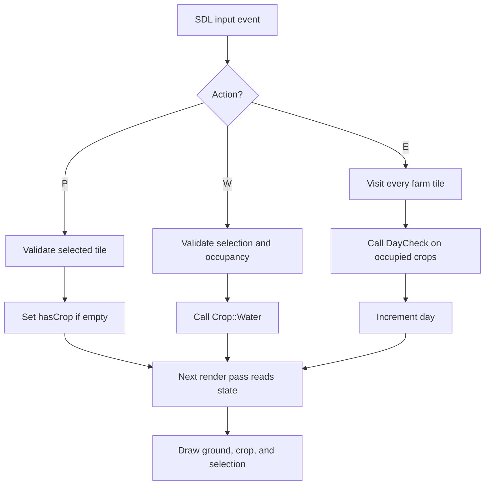

# Day 5 — SDL3 Farming Actions: Plant, Water, and End Day

> **Checkpoint:** The SDL3 prototype can select a tile with the mouse, plant a crop with **P**, water the selected crop with **W**, and advance the day with **E**. The existing `Crop` class continues to own crop lifecycle rules.
>
> **Project:** `small-farming-rpg`  
> **Graphics library:** SDL3 (installed version reported as 3.4.18)  
> **C++ standard:** C++17

---

## 1. What we built today

The graphical prototype now connects player input to the farm's actual state:

1. Click a tile to select it. A black outline shows the current selection.
2. Press **P** to plant on that tile, but only if the tile is empty.
3. Press **W** to water the selected crop, but only if a crop is present.
4. Press **E** to end the day. Each planted crop receives one `DayCheck()` call, then the day number advances.
5. The renderer redraws the farm from the current state, so changes to `hasCrop` and the crop stage become visible.

This is a meaningful game loop: **input → validate → update game state → render the new state**.

## 2. Current project architecture

```text
farming-rpg/
├── main.cpp               # Console version; still kept as a working reference
├── farm.hpp               # Shared Crop class and Tile struct
└── sdl3_window.cpp    # SDL3 window, events, farm rendering, and interactions
```

The exact filenames may change as the project matures; `sdl3_window.cpp` is still a prototype-oriented name.

### Why are there two `.cpp` files with `main()`?

Each executable needs its own entry point, so it is valid for the console program and SDL program to have separate `main()` functions **as long as they are compiled into separate executables**.

The console build remains:

```bash
g++ -std=c++17 -Wall -Wextra -Wpedantic main.cpp -o farm
```

The SDL program is compiled separately with SDL3's compiler/linker flags:

```bash
g++ -std=c++17 -Wall -Wextra -Wpedantic \
    sdl3_window.cpp -o sdl3_window \
    $(pkg-config --cflags --libs sdl3)
```

`farm.hpp` shares the **type definitions** between these programs. It does not share live runtime state: each running program has its own farm array in memory.

### Responsibilities by file

- `farm.hpp`: `Crop` and `Tile` definitions.
- `main.cpp`: console menus, `std::cin`, console display, and the console program's `main()`.
- `sdl3_window.cpp`: SDL initialization, window and renderer, event polling, mouse selection, keyboard actions, and drawing.

The long-term aim is to make the SDL game the graphical version of the farming RPG while keeping crop rules separate from presentation wherever practical. We are not rewriting the working console program just to add graphics.

---

## 3. The farm's state

The SDL program declares its farm before the main loop:

```cpp
Tile farm[3][3];
int selectedRow = -1;
int selectedCol = -1;
int day = 1;
bool running = true;
```

### Why are these outside `while (running)`?

The outer loop repeats many times per second. If the farm were declared inside it, it would be recreated on every iteration and planting would appear to disappear almost immediately.

Keeping the farm, selection, and day counter outside the loop means they persist between frames.

### What does an empty tile contain?

`Tile` is defined roughly as:

```cpp
struct Tile {
    bool hasCrop = false;
    Crop crop;
};
```

Every `Tile` contains a `Crop` object—even when `hasCrop` is false. Therefore:

- `hasCrop` answers **“Is a crop planted here?”**
- `crop.GetStage()` answers **“What stage is this crop in?”**

A default `Crop` starts at `Crop::Seed`, but that does *not* mean the tile has a planted crop. Always check `hasCrop` before treating the crop object as an occupied tile.

---

## 4. Existing feature: mouse tile selection

Mouse selection was implemented in the previous milestone, so this note will not reteach its coordinate formulas.

For Day 5, the important fact is that the SDL program already stores the selected tile in `selectedRow` and `selectedCol`. Those indexes are used by the P and W key handlers to decide which element of `farm[3][3]` to access. The selection starts at `-1, -1`, meaning no tile is selected; always validate that state before indexing the array.

For the screen-coordinate formulas, tile spacing, and gap checks, refer to **Day 4 — SDL3 Coordinate Formulas & Farm Geometry**.

---

## 5. Planting with P

The keyboard event branch recognizes a fresh P press:

```cpp
else if (event.type == SDL_EVENT_KEY_DOWN &&
         event.key.key == SDLK_P &&
         !event.key.repeat) {
    // Validate selection and plant.
}
```

- `SDL_EVENT_KEY_DOWN` means a key was pressed.
- `event.key.key == SDLK_P` checks that the key was P.
- `!event.key.repeat` ignores repeated key-down events caused by holding the key.

The planting rules are:

```cpp
if (selectedRow < 0 || selectedCol < 0) {
    std::cout << "Select a tile first!\n";
}
else if (farm[selectedRow][selectedCol].hasCrop) {
    std::cout << "That tile is already occupied!\n";
}
else {
    farm[selectedRow][selectedCol].hasCrop = true;
    std::cout << "Seed planted!\n";
}
```

### Why check the selection first?

At startup, `selectedRow` and `selectedCol` are `-1`, meaning “nothing selected.” If the code accessed `farm[-1][-1]`, it would access outside the array, which is undefined behavior. Checking the selection first prevents this.

### Why is setting `hasCrop` enough for this prototype?

The tile already contains a default-constructed `Crop`. Setting `hasCrop` to true makes the renderer treat that tile as planted. Its current stage starts at `Seed`.

The render loop already reads the tile's `hasCrop` and `GetStage()` values. The next frame shows the crop, so the planting branch does not need to directly draw anything.

---

## 6. Watering with W

The watering event follows the same keyboard pattern, but delegates the rules to `Crop::Water()`:

```cpp
else if (event.type == SDL_EVENT_KEY_DOWN &&
         event.key.key == SDLK_W &&
         !event.key.repeat) {

    if (selectedRow < 0 || selectedCol < 0) {
        std::cout << "Select a tile first!\n";
    }
    else if (!farm[selectedRow][selectedCol].hasCrop) {
        std::cout << "You can't apply water there.\n";
    }
    else {
        farm[selectedRow][selectedCol].crop.Water();
    }
}
```

We deliberately do **not** print a success message unconditionally after `Water()`. The method can reject watering—for example, because the crop was already watered that day, or because it has matured or withered. Printing “Water succeeded!” unconditionally would give a false report.

`Crop::Water()` currently prints through `std::cout`, which is convenient for this learning stage but couples gameplay logic to the console. We can improve action-result reporting for the graphical interface later, without duplicating the watering rules inside SDL's event handler.

---

## 7. Ending the day with E

The SDL event handler advances the game day like the console prototype did:

```cpp
else if (event.type == SDL_EVENT_KEY_DOWN &&
         event.key.key == SDLK_E &&
         !event.key.repeat) {

    for (int row = 0; row < 3; row++) {
        for (int col = 0; col < 3; col++) {
            if (farm[row][col].hasCrop) {
                farm[row][col].crop.DayCheck();
            }
        }
    }

    day++;
    std::cout << "Day " << day << " begins!\n";
}
```

### Why use nested loops?

Planting and watering affect one selected tile. Ending the day affects every planted crop, so the program visits the complete grid.

The `hasCrop` check is important: empty tiles have a default `Crop` object too, but empty tiles should not be processed as planted crops.

Each occupied crop receives exactly one `DayCheck()` call per E key press. The day number advances after the grid has been processed.

### Crop lifecycle rules remain in `Crop`

The SDL event handler does not implement growth or withering itself. It delegates to the existing class:

- A successful watering sets `wateredToday`.
- `DayCheck()` updates watering progress and applies growth rules.
- Three successful watering days advance a seed to a sprout, then another three advance a sprout to mature.
- Missing watering for two consecutive days causes the crop to wither under the current grace rules.
- Matured and withered crops cannot be watered under the current implementation.

After `DayCheck()` changes a crop's stage, the next render pass reads `GetStage()` and chooses a corresponding visual marker.

---

## 8. Rendering follows state changes

The render loop repeatedly:

1. Clears the rendering target with the background color.
2. Visits the 3×3 grid.
3. Draws green ground for empty tiles and brown ground for occupied tiles.
4. If occupied, draws a small marker using `crop.GetStage()` to select its color.
5. Draws a black outline around the selected tile.
6. Calls `SDL_RenderPresent()` to show the finished frame.

The rendering loop does **not** decide when crops grow. It reads state and displays it. The event handlers trigger actions; the `Crop` class applies lifecycle rules; the renderer presents the result.



---

## 9. Verified manual test checklist

The user tested the main interactions and reported that they worked.

- [x] SDL window opens and stays open until its close event is received.
- [x] The 3×3 grid renders.
- [x] Clicking a valid tile updates the selection outline.
- [x] Clicking in a gap does not select a tile.
- [x] Pressing P with no selection is handled without accessing an invalid index.
- [x] Pressing P on an empty tile plants a visible seed.
- [x] Planting again on an occupied tile is rejected.
- [x] Pressing W with no selection is rejected.
- [x] Watering an empty tile is rejected.
- [x] A planted crop can be watered, and a second watering on the same day is rejected by `Crop::Water()`.
- [x] Pressing E processes planted crops and increments the day.
- [x] Existing crop stage and withering behavior is driven by `Crop::DayCheck()`.

The day and action messages still appear in the terminal. On-screen UI, harvesting, inventory, saving/loading, and other systems remain deliberately postponed.

---

## 10. Current controls

| Input | Action |
|---|---|
| Left mouse click on a tile | Select tile |
| `P` | Plant on selected empty tile |
| `W` | Water selected crop |
| `E` | End day and update planted crops |
| Window close button | Exit the SDL program |

---

## 11. What we learned

- SDL input handling should trigger game actions, not duplicate all gameplay rules.
- Check array indexes before accessing the farm.
- The farm state persists because it is declared outside the main loop.
- A tile's occupancy (`hasCrop`) is different from the crop's lifecycle stage (`GetStage()`).
- Drawing repeatedly from current state means the renderer reflects gameplay changes without each action manually drawing the altered tile.
- SDL rendering order matters: ground first, crop marker second, selection outline last.
- Console output is currently a temporary feedback mechanism; it can be replaced with graphical UI later.
- Keeping the console and SDL programs as separate executables allows the old prototype to remain a working reference while the graphical version develops.

## 12. Self-check questions

Try answering these without immediately reading the answers above:

1. Why must `farm`, `selectedRow`, `selectedCol`, and `day` live outside `while (running)`?
2. Why does the planting handler check the selection before accessing `farm[selectedRow][selectedCol]`?
3. Why does planting only need to set `hasCrop = true` in our current model?
4. Why does the SDL watering handler call `Crop::Water()` instead of implementing its own watering-progress rules?
5. Why should it not always print a success message after calling `Water()`?
6. Why does End Day loop over all tiles rather than using `selectedRow` and `selectedCol`?
7. Why do we call `DayCheck()` only when `hasCrop` is true?
8. What is the difference between changing game state and drawing a frame?
9. Why can `main.cpp` and `sdl3_window.cpp` each have a `main()` function without conflict when built separately?
10. Why do the P and W handlers need to validate `selectedRow` and `selectedCol` before indexing `farm`?

### Answers for later review

1. So state persists between frames instead of being reset every loop iteration.
2. Because the initial selection is `-1`, which is not a valid array index.
3. The `Tile` already contains a default `Crop`; `hasCrop` distinguishes an occupied tile from an empty one.
4. So the existing `Crop` class remains the single owner of watering rules.
5. Because watering can be rejected for valid gameplay reasons.
6. Ending the day affects every planted crop, not only one selected tile.
7. Empty tiles also contain default `Crop` objects, which should not be treated as planted crops.
8. State changes modify the stored game data; rendering reads that data and displays it.
9. Each source file is compiled into a different executable, so each executable has its own single entry point.
10. Because the selection initially uses `-1, -1`, and those are invalid array indexes. Checking for a valid selection prevents accessing `farm` outside its bounds.

---

## 13. Next milestone

The basic interaction loop now works. Sensible next steps are to replace terminal-only action messages with a simple on-screen status display, or to refactor `Crop::Water()`'s result reporting so the graphical interface can show successes and failures without relying on `std::cout`. We should choose one focused task at a time and leave postponed systems—harvesting, inventory, shops, and persistence—out until they are needed.
