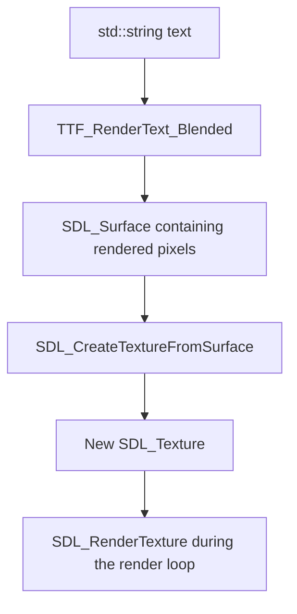

# Day 8 — SDL3 Farming RPG: Notification Timing, Reusable Text Rendering, and Build Workflow

Today we improved the existing game rather than adding a new farming mechanic. We made notifications temporary, added a translucent background panel, reused one function for creating/updating text textures, handled notification-timer updates more carefully, and created a basic `Makefile`.

The main ideas were:

- Measure elapsed time without pausing the game loop.
- Understand the difference between **not drawing** a texture and **destroying** it.
- Draw a UI panel behind text and use alpha blending.
- Put repeated surface-to-texture work in one helper function.
- Use a function's return value when the caller needs to react to success or failure.
- Use `make` to avoid manually typing a long compiler command every time.

---

## 1. Temporary notifications

### The problem

Before this improvement, a message such as `Seed planted!` stayed on screen until another notification replaced it. That worked, but it could leave old feedback hanging around indefinitely.

We wanted a notification to appear briefly, then stop being drawn while the rest of the game continued running.

### Record the time a notification is shown

We added a timestamp variable near the other notification state:

```cpp
Uint64 notificationStartTime = 0;
```

`Uint64` is SDL's unsigned 64-bit integer type. `SDL_GetTicks()` returns the number of milliseconds elapsed since SDL initialization, so it can be used to measure elapsed time.

When a notification texture is updated successfully, we record the current time:

```cpp
notificationStartTime = SDL_GetTicks();
```

The planting and watering handlers now only reset this timestamp if `UpdateTextTexture()` reports success. Conceptually:

```cpp
bool textUpdated = UpdateTextTexture(
    renderingPointer,
    font,
    notificationText,
    textColor,
    notificationTexture,
    notificationRect
);

if(textUpdated) {
    notificationStartTime = SDL_GetTicks();
}
```

The actual formatting can follow the style used in the source file; the important behavior is the conditional timestamp update.

### Why reset the timestamp for every new message?

Suppose a message appears at 1,000 ms. The player triggers another message at 1,800 ms. If we keep the old timestamp, the second message inherits the first message's age and could disappear almost immediately.

Recording a fresh timestamp after a successful update gives the new message its own display period.

### Stop drawing after 1,500 ms

The notification-rendering condition now checks both that a texture exists and that it has not exceeded its display duration:

```cpp
if(notificationTexture != nullptr &&
   SDL_GetTicks() - notificationStartTime < 1500) {
    // Draw the notification panel and text here.
}
```

The expression

```cpp
SDL_GetTicks() - notificationStartTime
```

calculates how many milliseconds have elapsed since the timestamp was recorded. The comparison `< 1500` keeps the notification visible for approximately 1.5 seconds.

### Why not use `SDL_Delay(1500)`?

`SDL_Delay()` pauses the thread that calls it. If we used it to make a message disappear, the game could stop processing input and drawing frames during that wait. The elapsed-time check is **non-blocking**: the normal event and rendering loops continue, and the notification simply stops being drawn when its time is up.

### Important distinction: hidden is not destroyed

When the elapsed-time condition becomes false, the program skips the notification's drawing calls. It does **not** automatically destroy `notificationTexture`.

That is intentional for this design. The texture can remain allocated and be reused/replaced when another notification appears. It is released during shutdown, or when `UpdateTextTexture()` successfully replaces it.

---

## 2. A translucent background panel behind notifications

White text can be hard to read when it is drawn over a changing grassy background. We added a dark panel behind the notification to improve contrast.

### Build the panel rectangle from the text rectangle

The notification has a destination rectangle named `notificationRect`. We created a slightly larger rectangle around it:

```cpp
SDL_FRect notificationPanelRect{
    notificationRect.x - 8.0f,
    notificationRect.y - 5.0f,
    notificationRect.w + 16.0f,
    notificationRect.h + 10.0f
};
```

The values provide padding around the text:

- Subtract `8` from `x`, then add `16` to the width: 8 pixels of padding on both horizontal sides.
- Subtract `5` from `y`, then add `10` to the height: 5 pixels of padding above and below.

Because this rectangle is based on `notificationRect`, it follows the text's dimensions when a new notification has a different width or height.

### Choose a color and fill the rectangle

The panel uses a dark color, with an alpha value of `160`:

```cpp
SDL_SetRenderDrawColor(renderingPointer, 24, 29, 24, 160);
SDL_RenderFillRect(renderingPointer, &notificationPanelRect);
```

These calls have different jobs:

- `SDL_SetRenderDrawColor()` configures the color used by subsequent renderer drawing operations.
- `SDL_RenderFillRect()` actually draws a filled rectangle using the configured draw color.

An alpha value of `160` out of `255` gives the panel roughly 63% opacity. This was the value chosen after trying the panel visually.

### Enable blending

We also set the renderer's draw blend mode during setup:

```cpp
SDL_SetRenderDrawBlendMode(renderingPointer, SDL_BLENDMODE_BLEND);
```

Alpha describes the color's opacity, while the blend mode controls how the drawing operation combines that color with pixels already in the rendering target. The alpha value alone is not a substitute for configuring blending.

### Drawing order matters

The notification section draws the panel before the text:

```cpp
SDL_RenderFillRect(renderingPointer, &notificationPanelRect);
SDL_RenderTexture(renderingPointer, notificationTexture, nullptr, &notificationRect);
```

The order is important:

1. Draw the farm scene.
2. Draw the notification panel over the scene.
3. Draw the text over the panel.

If the panel were drawn after the text, it could obscure the letters. Since the panel is translucent, the farm remains visible through it.

---

## 3. The reusable `UpdateTextTexture()` helper

This was the main code-organization improvement of the day.

### The duplication we removed

Originally, the startup code created the initial `Day 1` text texture manually. The `E` key handler had another block for creating an updated day texture. The notification system also needed to create and replace text textures.

All three jobs follow the same general pipeline. Keeping separate copies of that pipeline makes the code longer and gives us more places to fix if the process changes.

We created a reusable helper with a signature equivalent to:

```cpp
bool UpdateTextTexture(
    SDL_Renderer* renderer,
    TTF_Font* font,
    const std::string& text,
    SDL_Color color,
    SDL_Texture*& texture,
    SDL_FRect& destination
);
```

The helper receives the text and the existing texture/rectangle to update. It returns `true` if a replacement texture was created successfully, or `false` if a rendering/texture-creation step failed.

### The text-rendering pipeline

The process is:



The stages have different responsibilities:

- **`std::string`:** the characters we want to show, such as `Day 3` or `Seed planted!`.
- **`TTF_RenderText_Blended()`:** rasterizes those characters using the selected font and color, returning an `SDL_Surface`.
- **`SDL_Surface`:** a real image represented by pixel data in memory. In this workflow it is an intermediate image because we use it to create a texture.
- **`SDL_CreateTextureFromSurface()`:** creates a renderer-oriented `SDL_Texture` from that surface.
- **`SDL_RenderTexture()`:** draws the texture into the game window.

The surface is not a fake or lesser image. It is an intermediate step in this particular pipeline. We release it after its pixel data has been used to create the texture and after we have read the dimensions we need.

### Why does `text.c_str()` appear in the helper?

The helper accepts a C++ string:

```cpp
const std::string& text
```

SDL_ttf's text-rendering function expects a character pointer. Calling `text.c_str()` provides a pointer to the string's null-terminated character sequence:

```cpp
TTF_RenderText_Blended(font, text.c_str(), 0, color);
```

The `0` length argument means to use the null terminator to determine the end of the text for this call. `c_str()` does not render the text itself and does not transfer ownership of the string.

### How the helper updates an existing texture safely

The helper follows this order:

1. Render the requested string into a new surface.
2. If surface creation fails, report the failure and return `false`.
3. Create a new texture from that surface.
4. If texture creation fails, destroy the temporary surface, report the failure and return `false`. The caller's existing texture remains untouched.
5. Copy the surface's width and height into the destination rectangle.
6. Destroy the old texture if it is not `nullptr`.
7. Assign the new texture to the caller's texture pointer.
8. Destroy the temporary surface.
9. Return `true`.

The central success-path operations look like this:

```cpp
destination.w = static_cast<float>(textSurface->w);
destination.h = static_cast<float>(textSurface->h);

if(texture != nullptr) {
    SDL_DestroyTexture(texture);
}

texture = newTexture;
SDL_DestroySurface(textSurface);
return true;
```

**Read the order carefully:** the dimensions are copied before `textSurface` is destroyed. The old texture is destroyed only after the new texture has been created successfully. The new pointer is assigned to `texture`, not the other way around.

### Why are `texture` and `destination` references?

The last two parameters are:

```cpp
SDL_Texture*& texture,
SDL_FRect& destination
```

- `SDL_Texture*& texture` is a **reference to a texture pointer**. This allows the helper to replace the caller's actual pointer, such as `dayTexture` or `notificationTexture`.
- `SDL_FRect& destination` is a reference to the caller's actual rectangle. This lets the helper update its width and height while leaving its `x` and `y` position intact.

Without the references, passing ordinary copies would mean changing local copies rather than updating the variables used by the rendering loop.

### The helper's three uses

We now use the same helper for:

1. **Initial text creation:** `dayTexture` starts as `nullptr`, and the helper creates the first `Day 1` texture. `dayRect` starts with its intended position and zero dimensions; the helper fills in the dimensions.
2. **Day updates:** after `day++`, we form a new string such as `Day 2` and call the helper to replace `dayTexture` and resize `dayRect` as needed.
3. **Notifications:** the planting and watering handlers set `notificationText` and call the helper with `notificationTexture` and `notificationRect`.

The helper does not know what the text means. It handles the mechanics of replacing a text texture; the calling code decides what message should be shown and when.

### Why check the helper's return value for notifications?

The notification timer should reset only if the new notification texture was successfully created. Otherwise, an update failure could leave the old texture on screen while giving it a fresh timer.

We now use the helper's `bool` result so `notificationStartTime` is updated only after a successful notification-text update. The planting and watering callers use this pattern.

The day-counter handler calls the helper too, but it has no notification timestamp to reset. In the current design, the helper still reports text-rendering/texture-creation failures to `std::cerr`, and the old texture remains if replacement creation fails. More elaborate recovery behavior can be considered later if needed.

---

## 4. Resource cleanup

Textures are renderer-associated resources, so we destroy them before destroying the renderer.

The current cleanup sequence includes:

```cpp
SDL_DestroyTexture(notificationTexture);
SDL_DestroyTexture(terrainSheet);
SDL_DestroyTexture(cropSheet);
SDL_DestroyTexture(dayTexture);
SDL_DestroyRenderer(renderingPointer);
SDL_DestroyWindow(window);
TTF_CloseFont(font);
TTF_Quit();
SDL_Quit();
```

The important dependency principles are:

- Destroy textures before their renderer.
- Destroy the renderer before destroying the window it uses.
- Close the font before calling `TTF_Quit()`.
- Shut down SDL_ttf before the final `SDL_Quit()` call.

A notification texture may still exist even after its display time has expired, so it still needs to be destroyed during shutdown.

The cleanup above reflects the project's current working order; keep any other resource-specific cleanup that is present in the source file.

---

## 5. The Makefile

We got tired of manually typing the complete compiler command every time we wanted to rebuild. Our source files are under `src/`, while the executable is written to `output/`.

The working Makefile has this general structure:

```makefile
CXX = g++
CXXFLAGS = -std=c++17 -Wall -Wextra -Wpedantic

PKG_CONFIG = pkg-config
SDL_PACKAGES = sdl3 sdl3-image sdl3-ttf

.PHONY: all clean

all: output/sdl3_window

output/sdl3_window: src/sdl3_window.cpp src/farm.hpp
	mkdir -p output
	$(CXX) $(CXXFLAGS) src/sdl3_window.cpp -o output/sdl3_window $(shell $(PKG_CONFIG) --cflags --libs $(SDL_PACKAGES))

clean:
	rm -f output/sdl3_window
```

**Important:** the two recipe lines under `output/sdl3_window:` and the line under `clean:` must start with a literal Tab. A line such as `mkdir -p output` must be part of a target's recipe; it should not sit by itself among the variable definitions.

### What the parts mean

- `CXX` is the compiler command.
- `CXXFLAGS` holds the C++ standard and warning flags.
- `PKG_CONFIG` names the tool used to query installed library build flags.
- `SDL_PACKAGES` lists the SDL libraries this program uses.
- `all` is the default target, so running `make` builds `output/sdl3_window`.
- The executable target lists `src/sdl3_window.cpp` and `src/farm.hpp` as prerequisites. If one is newer than the executable, `make` reruns the recipe.
- `mkdir -p output` creates the output directory if needed and does not complain if the directory already exists.
- The compiler recipe builds the executable and obtains the necessary SDL compile/link flags via `pkg-config`.
- `.PHONY: all clean` tells `make` these are command-like targets rather than ordinary files to produce.
- `clean` removes the compiled executable with `rm -f output/sdl3_window`.

### Commands we can now use

Build the game:

```bash
make
```

Remove the compiled executable:

```bash
make clean
```

After cleaning, run `make` again to rebuild.

If `make` reports `Nothing to be done for 'all'.`, that normally means the target exists and is newer than the prerequisites listed in the Makefile. It is a sign that `make` is tracking the declared target instead of blindly recompiling every time.

### Current limitation

The Makefile explicitly lists `farm.hpp` as a dependency. If we add more headers, they should also be tracked, or we can later learn automatic dependency generation. That improvement is not necessary just to understand and use this first Makefile.

---

## 6. Testing checklist

Use this to verify the features after changes to notification rendering or the build setup.

### Notification behavior

- [ ] Planting successfully displays the success notification.
- [ ] Attempting to plant on an occupied tile displays the expected failure notification.
- [ ] Pressing `W` without a selected tile displays the selection warning.
- [ ] Pressing `W` on an empty tile displays the empty-tile warning.
- [ ] Watering a crop displays the message corresponding to its `WaterResult`.
- [ ] A notification disappears after approximately 1.5 seconds.
- [ ] A new notification gets its own 1.5-second period.
- [ ] The game continues responding while a notification is visible.
- [ ] The panel is drawn behind the text and its alpha value is `160`.
- [ ] The day counter continues updating when `E` is pressed.
- [ ] Closing the game works even if a notification texture has been created.

### Build workflow

- [ ] `make` builds `output/sdl3_window` when needed.
- [ ] Running `make` again without modifying tracked prerequisites reports that the target is up to date.
- [ ] `make clean` removes `output/sdl3_window`.
- [ ] `make` rebuilds the executable after cleaning.
- [ ] The build can create the `output/` directory when it does not exist.

---

## 7. Common mistakes and why they happen

### Updating the timestamp when texture creation fails

**Problem:** the old texture remains, but it receives a fresh display timer even though the new message was never created.  
**Prevention:** update `notificationStartTime` only when `UpdateTextTexture()` returns `true`.

### Reading the surface after destroying it

**Problem:** `textSurface` is no longer valid after `SDL_DestroySurface(textSurface)`.  
**Prevention:** copy the surface dimensions into `destination` before destroying the surface.

### Replacing the pointer in the wrong direction

**Problem:** `newTexture = texture` overwrites the new pointer with the old pointer, instead of replacing the caller's texture.  
**Correct operation:** `texture = newTexture` after the new texture has been created successfully and the old texture has been released.

### Destroying the old texture too early

**Problem:** if creating the replacement fails, the program loses the valid old texture.  
**Prevention:** create the replacement first. Only destroy the old texture after the replacement exists.

### Assuming expired means freed

**Problem:** the notification disappears, but its texture remains allocated.  
**Prevention:** distinguish drawing visibility from resource lifetime; cleanup is still required.

### Placing a Makefile command outside a recipe

**Problem:** Makefile commands must belong to a target recipe and begin with a literal Tab.  
**Prevention:** put `mkdir -p output` directly under the executable target, before the compiler command.

---

## 8. What we learned today

1. **Elapsed time is better than pausing the game.** Store a timestamp and compare elapsed milliseconds to make temporary UI behavior non-blocking.
2. **Drawing and destruction are different.** A texture can remain allocated while it is not being drawn.
3. **Render order creates visual layers.** The farm goes beneath the panel; the notification text goes on top of the panel.
4. **Alpha needs blending to have the intended visual effect.** Alpha expresses opacity; the blend mode controls how the color combines with existing pixels.
5. **A helper function reduces duplicated work.** Initialization, day updates, and notifications now share the same text-texture replacement process.
6. **References let the helper update caller-owned variables.** The helper replaces the caller's texture pointer and updates its destination rectangle.
7. **Return values should inform caller behavior.** The notification timer is reset only when the text update succeeds.
8. **A build system records the command and its prerequisites.** `make` and `make clean` replace a long manual build command and repetitive cleanup.

---

## 9. What's intentionally left for later

- More elaborate recovery behavior if creating a day-counter texture fails. Currently, the helper reports the error and leaves the old texture intact.
- A dedicated logging policy. Terminal messages are intentionally retained during development, even though notifications are also shown in the game window.
- Automatically destroying the notification texture when its timer expires. For now, expiration only stops drawing; the texture is replaced by later notifications or destroyed during shutdown.
- Additional gameplay systems. Harvesting is the next planned feature, followed later by inventory, an economy, and save/load. Those belong to the next gameplay phase, not today's UI/build work.
- More advanced Makefile dependency generation if the project gains more headers.

## Day 8 checkpoint

**Completed:** temporary notifications, a translucent panel, shared text-texture creation for the day counter and notifications, conditional notification-timer resets, resource cleanup, and a basic Makefile.

The next planned gameplay milestone is **Phase 3: Core Gameplay Expansion**, starting with harvesting. The first step should be to define harvesting rules and the effects on `Crop` and `Tile` before writing implementation code.
