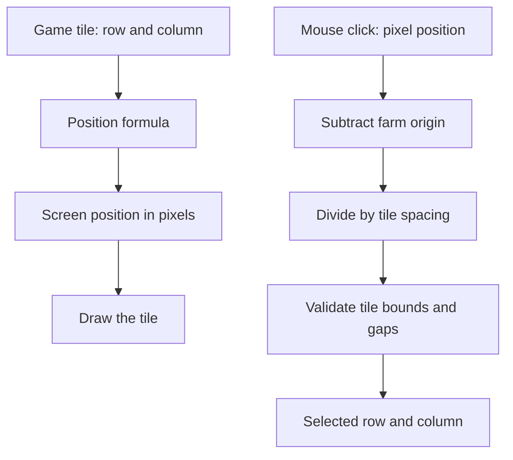

# SDL3 Learning Notes — Screen Coordinates, Farm Tiles, and Mouse Selection

> **Project:** `small-farming-rpg`  
> **Phase:** SDL3 graphical prototype  
> **Purpose:** Explain the positioning and mouse-coordinate formulas in simple language, with worked examples that can be understood later without reopening the lesson.

---

## 1. The big idea

Our farm exists in two related forms:

1. **Game coordinates** identify a tile in our C++ array. We use a `row` and a `col` (column).
2. **Screen coordinates** identify a position in the SDL window. We use pixel values `x` and `y`.

For example, the middle tile in a 3×3 farm is `farm[1][1]` in C++. But SDL needs to know where that tile should appear in the window, such as pixel position `(500, 280)`.

The formulas connect these two forms:

- **Drawing:** row and column → screen pixel position.
- **Mouse selection:** screen pixel position → row and column.



## 2. Screen coordinates: where is `(0, 0)`?

Think of the game window as a sheet of graph paper. Every point has an `x` and a `y` coordinate.

SDL's usual 2D rendering coordinates work like this:

- `(0, 0)` is at the **top-left** of the rendering area.
- Increasing `x` moves **right**.
- Increasing `y` moves **down**.

This is different from the graph layout often used in mathematics, where positive `y` points upward.

```text
(0, 0) ------------------------------> +x (right)
  |
  |
  |
  |
  v
 +y (down)
```

Coordinates tell us **where** something begins. They do not tell us how large it is.

## 3. What does `SDL_FRect` mean?

SDL's `SDL_FRect` describes a rectangle using four values:

```cpp
SDL_FRect tileRect{x, y, 90.0f, 90.0f};
```

The values mean:

| Value | Meaning | Example |
|---|---|---:|
| `x` | Left edge of the rectangle | `400` |
| `y` | Top edge of the rectangle | `180` |
| `w` | Width | `90` |
| `h` | Height | `90` |

So this rectangle starts at `(400, 180)` and is 90 pixels wide and 90 pixels tall.

**Common confusion:** `w` and `h` are sizes, not the coordinates of the opposite corner. The rectangle's position is `(x, y)`; its size is `(w, h)`.

## 4. The farm's origin

The **origin** is simply the screen position where the farm grid starts: the top-left corner of the top-left tile.

In our current SDL test, the grid starts at:

```cpp
float x = 400 + col * 100;
float y = 180 + row * 100;
```

That means:

- Farm origin X = `400` pixels.
- Farm origin Y = `180` pixels.

The first tile (`row == 0`, `col == 0`) therefore starts at `(400, 180)`.

We choose this starting position to put the farm somewhere useful in the window. We could choose a different origin later to move the whole farm without changing its row/column structure.

## 5. Formula A — game tile to screen position

Our farm is a 3×3 array:

```cpp
Tile farm[3][3];
```

Valid indexes are `0`, `1`, and `2` for both rows and columns.

### Horizontal position (`x`)

```text
x = originX + col × spacing
```

In our current layout:

```text
x = 400 + col × 100
```

Why use `col`? Because the **column tells us how far to move to the right**.

- Column `0`: `400 + 0 × 100 = 400`
- Column `1`: `400 + 1 × 100 = 500`
- Column `2`: `400 + 2 × 100 = 600`

### Vertical position (`y`)

```text
y = originY + row × spacing
```

In our current layout:

```text
y = 180 + row × 100
```

Why use `row`? Because the **row tells us how far to move down**.

- Row `0`: `180 + 0 × 100 = 180`
- Row `1`: `180 + 1 × 100 = 280`
- Row `2`: `180 + 2 × 100 = 380`

### Why is there multiplication?

Each step across or down moves the tile by 100 pixels. If a tile is two steps away from the first tile, we need two spacing units:

```text
distance = number of steps × spacing
```

That is why column and row are multiplied by the spacing.

### Worked example: `row = 1`, `col = 2`

```text
x = 400 + 2 × 100 = 600
y = 180 + 1 × 100 = 280
```

That tile's upper-left corner is at screen position `(600, 280)`.

### Position table

| Row | Column | X | Y | Top-left screen position |
|---:|---:|---:|---:|---|
| 0 | 0 | 400 | 180 | `(400, 180)` |
| 0 | 1 | 500 | 180 | `(500, 180)` |
| 0 | 2 | 600 | 180 | `(600, 180)` |
| 1 | 0 | 400 | 280 | `(400, 280)` |
| 1 | 1 | 500 | 280 | `(500, 280)` |
| 1 | 2 | 600 | 280 | `(600, 280)` |
| 2 | 0 | 400 | 380 | `(400, 380)` |
| 2 | 1 | 500 | 380 | `(500, 380)` |
| 2 | 2 | 600 | 380 | `(600, 380)` |

Notice the pattern: moving to the next column changes `x`, while staying in the same row keeps `y` unchanged. Moving to the next row changes `y`, while staying in the same column keeps `x` unchanged.

## 6. Tile size is not the same as spacing

Our current layout uses:

- Tile width and height: `90` pixels.
- Spacing between tile starting positions: `100` pixels.

So there is a 10-pixel gap between neighbouring tiles.

```text
Tile (90 px) + gap (10 px) = spacing (100 px)
```

For example, a tile starting at `x = 400` occupies the horizontal interval from `400` up to (but not including) `490`. The next tile starts at `500`. The 10 pixels in between are the gap.

This is why the position formula uses `100`, not `90`: we want every tile's **starting point** to be 100 pixels farther along.

If we later want tiles that touch with no gap, tile size and spacing could both be `90`.

It is useful to keep these as separate ideas:

- **Tile size** answers: “How big is the rectangle?”
- **Spacing** answers: “How far apart are the tile starting points?”

## 7. Formula B — centring a crop marker inside a tile

Our tile is `90 × 90`. The marker we draw for the crop is `30 × 30`.

We want the smaller marker to sit in the centre of the larger tile.

### Step 1: find the extra space

```text
extra space = tile size - marker size
            = 90 - 30
            = 60 pixels
```

### Step 2: split that space evenly on both sides

```text
offset = extra space ÷ 2
       = 60 ÷ 2
       = 30 pixels
```

So the marker starts 30 pixels to the right and 30 pixels down from the tile's top-left corner.

General formula:

```text
offset = (container size - marker size) / 2
```

For this game:

```cpp
SDL_FRect stageRect{
    x + 30,
    y + 30,
    30.0f,
    30.0f
};
```

- `x + 30` moves the marker right inside the tile.
- `y + 30` moves the marker down inside the tile.
- `30.0f, 30.0f` give the marker its width and height.

We do **not** need another loop to draw the marker. The marker belongs to the tile currently being processed, so it is drawn inside the existing nested loop.

This centring formula works whenever you want to centre one rectangle inside another rectangle of the same coordinate orientation.

## 8. Drawing order: why the ground must come first

Our draw calls change what is visible on the rendering target. If we draw a ground rectangle after drawing a crop marker, the ground can cover the marker.

For each tile, follow this order:

1. Choose the ground color (grass or soil).
2. Draw the large tile rectangle.
3. If the tile has a crop, choose a marker color based on its stage.
4. Draw the smaller crop marker.
5. If this tile is selected, draw its outline last.

In plain language: **draw the background first, then objects on top of it, then the selection border on top of everything else.**

`SDL_SetRenderDrawColor()` sets the renderer's current drawing color. `SDL_RenderFillRect()` then fills the rectangle with that color. It is therefore important to set the intended color before drawing each shape.

The selection test looks like this:

```cpp
if (row == selectedRow && col == selectedCol) {
    SDL_SetRenderDrawColor(renderingPointer, 0, 0, 0, 255);
    SDL_RenderRect(renderingPointer, &tileRect);
}
```

The `&&` means “and”. Both the current row and the current column must match the selected coordinates.

## 9. Formula C — mouse screen position back to row and column

When the player clicks, SDL gives us a mouse position in screen pixels. We need to discover which farm tile contains that position.

Our farm starts at `(400, 180)` and uses a spacing of `100`.

### Step 1: subtract the farm origin

Imagine a click at pixel position `(545, 325)`.

```cpp
int relativeX = 545 - 400; // 145
int relativeY = 325 - 180; // 145
```

Now `(relativeX, relativeY)` tells us how far into the farm area the click is. We subtract the origin so we don't have to work with the whole window's coordinates anymore.

General formula:

```text
relativeX = mouseX - originX
relativeY = mouseY - originY
```

### Step 2: divide by the spacing

Each 100-pixel interval belongs to a row or column index.

```text
column = relativeX / spacing
row    = relativeY / spacing
```

For our example:

```text
column = 145 / 100 = 1
row    = 145 / 100 = 1
```

In C++, because both values are integers, integer division discards the fractional part. `145 / 100` gives `1`, not `1.45`.

The click is in row `1`, column `1`—the middle tile—provided it did not land in a gap.

**Remember the order:** the first array index is `row`; the second is `col`. So the tile is `farm[1][1]`.

## 10. What does `%` (modulo) mean here?

The `%` operator gives the **remainder** after integer division. It helps us tell how far into a 100-pixel tile interval the click occurred.

For our example:

```text
relativeX = 145
145 / 100 = 1 remainder 45
145 % 100 = 45
```

The `45` tells us that the click is 45 pixels into column 1's 100-pixel interval.

Each interval is 100 pixels long, but the tile itself is only 90 pixels wide. Therefore:

- Remainder `0` through `89`: inside the tile.
- Remainder `90` through `99`: inside the 10-pixel gap.

The same logic applies vertically.

### Example of a click in a gap

Suppose `relativeX = 195`:

```text
column = 195 / 100 = 1
localX = 195 % 100 = 95
```

The interval points toward column `1`, but local position `95` is outside the 90-pixel tile. It is in the gap, so reject the click.

### Why bounds checks must happen first

Before calculating `farm[row][col]`, first check that the relative coordinates are within the total grid range:

```cpp
if (relativeX < 0 || relativeX >= 300 ||
    relativeY < 0 || relativeY >= 300) {
    continue;
}
```

Here, `||` means “or”. If either coordinate is outside the grid, ignore the click.

Then check the gaps:

```cpp
if (relativeX % 100 >= 90 ||
    relativeY % 100 >= 90) {
    continue;
}
```

Only after these checks is it safe to calculate the selected row and column and use them to index the farm array.

The `300` comes from 3 intervals × 100 pixels per interval. This check also catches clicks in the unused 10-pixel gap after the final tile; the modulo check rejects the gaps between tiles too.

### Complete conversion example

For a click at `(545, 325)`:

```text
Mouse position:   (545, 325)
Farm origin:      (400, 180)
Relative position:(145, 145)
Column:           145 / 100 = 1
Row:              145 / 100 = 1
Local X in slot:  145 % 100 = 45
Local Y in slot:  145 % 100 = 45
```

Since `45 < 90` for both directions, the click is inside the tile, not in a gap. The selected tile is `farm[1][1]`.

## 11. The mouse-handling pattern, in plain language

1. Receive a left mouse-button event.
2. Work out where the click is relative to the farm's top-left corner.
3. Reject it if it is outside the farm's overall range.
4. Check whether the click landed in one of the gaps.
5. Divide by the spacing to get column and row.
6. Store them in `selectedCol` and `selectedRow`.
7. During rendering, draw an outline around the tile whose row and column match the selected values.

This is why selection uses the same geometry as drawing. If you change the grid's origin or spacing, update both calculations so the visible tiles and mouse selection still line up.

## 12. A useful improvement: name the layout values

Right now, the values `400`, `180`, `90`, and `100` are written directly into formulas. These are often called **magic numbers**: values that work, but whose meaning is not obvious from the number alone.

Later, we can replace them with named constants:

```cpp
constexpr int GRID_X = 400;
constexpr int GRID_Y = 180;
constexpr int TILE_SIZE = 90;
constexpr int TILE_SPACING = 100;
constexpr int GRID_ROWS = 3;
constexpr int GRID_COLS = 3;
```

A named value makes the intention clearer and helps avoid inconsistent edits. For example, the drawing and mouse-selection code should use the same `GRID_X`, `GRID_Y`, and `TILE_SPACING` values.

We are not required to refactor the code immediately; first understand what each value means.

## 13. How these formulas fit the project architecture

These calculations belong to the graphical interface because they answer questions about pixels and mouse clicks.

- `farm.hpp`: defines the shared `Crop` and `Tile` types.
- `main.cpp`: keeps the console program's menu, text display, and keyboard input.
- `sdl3_window.cpp`: currently owns the graphical program's window, event loop, drawing, and selection.

The two `.cpp` files are separate executables, each with its own `main()` and its own live farm array. Including `farm.hpp` shares the **type definitions**, not the state of a running console process.

As the graphical game grows, we'll move gameplay operations into reusable code where useful. We are not trying to make the SDL program permanently ignore the console implementation; the console prototype is our working reference, and shared crop rules should remain shared rather than being copied into a second implementation.

## 14. Common mistakes and how to recognize them

| Mistake | What happens | Why |
|---|---|---|
| Using the tile size (`90`) as the spacing (`100`) | Tiles or mouse selection don't line up with the intended gaps | Size and distance between starts are different values |
| Drawing every tile at the same `x` and `y` | All tiles overlap | Position wasn't calculated from `row` and `col` |
| Swapping `row` and `col` | Tiles may be selected or mapped in the wrong orientation | Row is vertical; column is horizontal |
| Using `x + 30` without understanding `x` | Marker may appear in the wrong place if the tile position changes | `x` must already be the current tile's left edge |
| Drawing the tile after the marker | Marker disappears | The later filled rectangle covers the earlier drawing |
| Skipping the gap check | A click between tiles selects a nearby tile | Division alone identifies the interval, not whether the click hit the tile itself |
| Using a negative or out-of-range index | Invalid array access | Mouse coordinates were not validated before indexing the array |
| Updating the drawing origin but not the mouse origin | Mouse clicks select the wrong tile | Drawing and selection no longer use the same layout values |

## 15. Self-check: try these without looking at the answers

1. What does `(0, 0)` mean in SDL screen coordinates?
2. In `SDL_FRect r{400, 180, 90, 90}`, which numbers give the position, and which give the size?
3. Why is the formula for X based on `col`, but the formula for Y based on `row`?
4. With `originX = 400`, `originY = 180`, spacing `100`, what pixel position starts `row = 2`, `col = 0`?
5. Why do the tile size and spacing differ in this project?
6. Why is the centring offset `(90 - 30) / 2` instead of just `90 - 30`?
7. A click is at `(545, 325)`. What are its relative coordinates, row, and column?
8. What does `relativeX % 100` tell us?
9. Why do we check bounds and gaps before using `farm[row][col]`?
10. Why should the crop marker be drawn after the ground tile?

### Answers

1. The top-left of the rendering area.
2. `400` and `180` are position; `90` and `90` are width and height.
3. Columns move left/right; rows move up/down (in SDL, positive Y goes down).
4. X = `400 + 0 × 100 = 400`; Y = `180 + 2 × 100 = 380`; position `(400, 380)`.
5. Tiles are 90 pixels wide/high, while their start positions are 100 pixels apart, leaving a 10-pixel gap.
6. There are 60 unused pixels; splitting them evenly puts 30 on each side.
7. Relative `(145, 145)`, row `1`, column `1`; both remainders are `45`, so the click is inside the tile.
8. How far into the current 100-pixel interval the coordinate lies.
9. To avoid selecting a gap or using an invalid array index.
10. If the ground is drawn afterward, it can cover the crop marker.

---

## Key takeaway

Do not memorize the numbers as a mysterious formula. Ask what each number represents:

- **Origin:** where the farm starts on screen.
- **Row/column:** which tile we mean.
- **Spacing:** how far apart tile starting positions are.
- **Tile size:** how large each tile is.
- **Offset:** how far inside a tile to place a smaller centered object.
- **Relative mouse position:** how far the click is from the farm origin.
- **Division:** which row/column interval the click is in.
- **Modulo:** where the click lands inside that interval, which helps reject the gaps.

Once those ideas make sense, the formulas are just a compact way to express them.
